# Chapter 2: The Microprocessor and its Architecture

课程介绍 Intel 早期系列处理器，从 8086 到 Pentium4/Core2 为止，主要节点包含：

1. **8086 / 8088**
    - 奠定了 16 位 x86 架构;
    - 使用 16 位寄存器和 20 位物理地址，最多访问 **1 MiB** 内存;
    - 采用“段地址 × 16 + 偏移量”的寻址方式;
    - 只支持实模式，没有内存保护和特权级。

2. **80286**
    - 引入了**保护模式**;
    - 增加段描述符、GDT、LDT 和特权级，实现内存保护;
    - 使用 24 位物理地址，最多访问 **16 MiB** 内存;
    - 仍然属于 16 位处理器，尚未支持分页。

3. **80386**
    - x86 进入 32 位，即 **IA-32**;
    - 通用寄存器扩展为 EAX、EBX 等 32 位寄存器;
    - 提供 32 位线性地址空间，最大为 **4 GiB**;
    - 引入**分页**、CR3、二级页表和虚拟 8086 模式。

4. **Pentium 4 后期 / Core 2**
    - 开始广泛支持 **Intel 64（x86-64）**;
    - 通用寄存器扩展到 64 位，并增加 R8 $\sim$ R15;
    - 引入 Long Mode，包括 64-bit Mode 和 Compatibility Mode;
    - 使用多级页表，同时保留运行传统 32 位程序的能力。

----

<br><br>

## 一、寄存器相关

寄存器根据可见性分，包含两类（visible vs invisible）：

- program visible：编程时可在指令中显示寻址 $\rightarrow$ specified by the instructions;
- program invisible：编程时不可以被寻址到 $\rightarrow$ not addressable.

寄存器根据用途分类，则有 General Purpose Register（通用寄存器）, Special Purpose Register.

### 1.1 General Purpose Registers

<figure markdown id="fig-dsmem">
  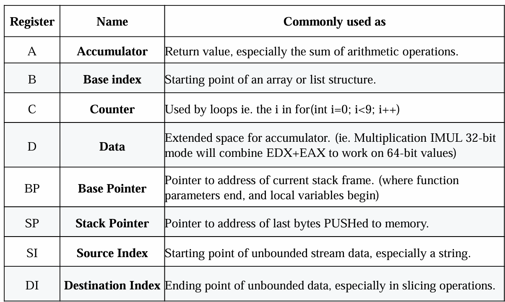{ width="500" }
  <figcaption>早期通用寄存器</figcaption>
</figure>


| 寄存器名称 | 通常用途 |
|---|---|
| A：累加器 | 保存返回值，尤其是算术运算的结果 |
| B：基址索引 | 数组或链表结构的起始位置 |
| C：计数器 | 用于循环，例如 `for( int i = 0; i < 9; i++ )` 中的 `i`. |
| D：数据 | 为累加器提供扩展空间。例如在 32 位模式下执行 `IMUL` 时，会组合 `EDX:EAX` 来保存 64 位结果 |
| BP：基址指针 | 指向当前栈帧的基址，即函数参数与局部变量的分界位置 |
| SP：栈指针 | 指向最后压入内存的数据，也就是栈顶 |
| SI：源索引 | 指向连续数据流的起始位置，尤其用于字符串操作，源字符串 |
| DI：目的索引 | 指向连续数据的目的位置，尤其用于复制等操作，目标字符串 |

在汇编语言中，部分寄存器是指只表示一个较大寄存器某一部分的寄存器。这个概念在 x86 汇编中尤其重要，因为根据体系结构和指令需要，可以按照 8 位、16 位、32 位或 64 位访问同一个寄存器。

-----

<br>

#### 1.1.1 基础通用寄存器

- RAX 可以作为以下不同位宽的寄存器使用。64 位寄存器 RAX, 32 位累加器 EAX, 16 位寄存器 AX, 两个 8 位寄存 AH 与 AL. 累加器用于乘法、除法以及某些调整指令。
- RBX 可以作为 RBX, EBX, BX, BH 或 BL 访问。在各种版本的微处理器中，它有时用于保存内存位置的偏移地址。
- RCX 可以作为 RCX, ECX, CX, CH 或 CL 访问。它是通用的计数寄存器，某些指令使用它保存计数值。
- RDX 可以作为 RDX, EDX, DX, DH 或 DL 访问。它是数据通用寄存器，在乘法中保存乘积的一部分，在除法前保存被除数的一部分。

在指令编码是，使用 EAX 的 `ADD` 指令比使用其他寄存器短 1 字节，因此代码密度更高，也对高速指令缓存更加友好：

```asm
ADD EAX, 0xffff0704    ; 编码后 05 04 07 FF FF
ADD EBX, 0xffff0704    ; 编码后 81 C3 04 07 FF FF
```

- RBP 可以作为 RBP, EBP, BP 或 BPL 访问。它是基址指针，指向当前栈帧的基址。
- RSI 可以作为 RSI, ESI, SI 或 SIL 访问。它是源索引寄存器，在字符串指令中用于寻址源字符串数据，当然也可以作为普通通用寄存器使用。
- RDI 可以作为 RDI, EDI, DI 或 DIL 访问。它是目的索引寄存器，在字符串指令中经常用于寻址目的字符串数据。

注意，低 8 位寄存器 BPL, SPL, SIL 和 DIL **只能在 64 位模式**下访问。

X86 架构下函数栈是由高地址向低地址延伸，一个函数在栈上所占用的数据空间是从 RBP 寄存器（高地址）到 RSP 寄存器（低地址）之间框定的，称为该函数的 stack frame（栈帧），栈帧从高地址向低地址分别存放着：函数参数、返回地址、保存的旧 RBP 值、函数局部变量、临时数据。所以当前 RBP 指向旧 RBP 值，RSP 指向当前 stack frame 延伸到的最低地址。


-----

#### 1.1.2 扩展通用寄存器

启用 64 位扩展时，Pentium4/Core2 中提供 R8 $\sim$ R15 寄存器。对于大多数指令，访问这些扩展通用寄存器需要使用 REX 前缀。

在 64 位模式下，通用寄存器包括：

- 16 个低 8 位寄存器：AL, BL, CL, DL, SIL, DIL, BPL, SPL, R8B $\sim$ R15B
- 4 个高 8 位寄存器：AH, BH, CH, DH，**只能在没有使用 REX 前缀时访问**
- 16 个 16 位寄存器：AX, BX, CX, DX, DI, SI, BP, SP, R8W $\sim$ R15W
- 16 个 32 位寄存器：EAX, EBX, ECX, EDX, EDI, ESI, EBP, ESP, R8D $\sim$ R15D
- 16 个 64 位寄存器：RAX, RBX, RCX, RDX, RDI, RSI, RBP, RSP, R8 $\sim$ R15

-----

#### 1.1.3 部分寄存器的写入

大多数 x86 寄存器都可以按照多种位宽访问。修改一个 32 位部分寄存器时，寄存器的高 32 位，即第 32 $\sim$ 63 位，会被自动清零。修改 8 位或 16 位部分寄存器时，其余位不会受到影响。这称为部分写入。部分写入会影响指令乱序执行，比如下例：

<figure markdown id="fig-dsmem">
  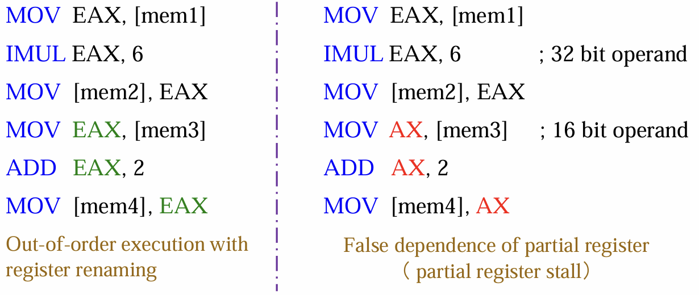{ width="500" }
  <figcaption>false dependence</figcaption>
</figure>

对于右半部分代码，`MOV AX, [mem3]` 指令必须等待前面的 `IMUL` 指令执行完成。这是因为 `AX` 只覆盖 `EAX` 的一部分，处理器仍然需要保留 `EAX` 的其他位，从而产生部分寄存器的虚假依赖，也称为部分寄存器停顿，降低执行效率。对于左半部分代码，EAX 中的新值不依赖 RAX 原来的值。这会建立一条全新且独立的数据依赖链，缩短整体依赖链，使 CPU 能够利用寄存器重命名进行乱序执行。所以要避免使用 32 以下的部分寄存器。

------

<br>

### 1.2  Special Purpose Registers

x86 架构下 Special Purpose Registers 主要包含三类：

| 类别 | 包含的寄存器 | 作用 |
|---|---|---|
| **指针寄存器** | RIP, RSP | RIP 指向下一条指令；RSP 指向当前栈顶 |
| **标志寄存器** | RFLAGS | 保存处理器的运算状态和控制信息 |
| **段寄存器** | CS, DS, ES, SS, FS, GS | 保存段选择子，用于选择代码段、数据段和栈段等 |

我还是更愿意把 RSP 列入 General Purpose Registers 中，因为编程时常用。

#### 1.2.1 RFLAGS

<figure markdown id="fig-dsmem">
  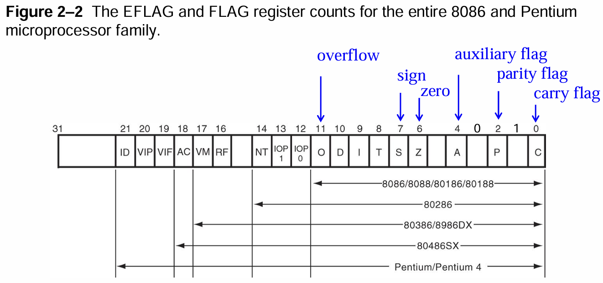{ width="500" }
  <figcaption>标志寄存器</figcaption>
</figure>


| 标志 | 位 | 英文名称 | 类型 | 作用 |
|---|---:|---|---|---|
| `CF` | 0 | Carry Flag | 状态标志 | 加法产生进位或减法产生借位时置位。 |
| `PF` | 2 | Parity Flag | 状态标志 | 结果的最低字节中包含偶数个 `1` 时置位；包含奇数个 `1` 时清零。 |
| `AF` | 4 | Auxiliary Carry Flag | 状态标志 | bit 3 与 bit 4 之间产生进位或借位时置位，主要用于 BCD 运算。 |
| `ZF` | 6 | Zero Flag | 状态标志 | 算术或逻辑运算的结果为零时置位。 |
| `SF` | 7 | Sign Flag | 状态标志 | 保存运算结果的符号，即结果的最高有效位。 |
| `TF` | 8 | Trap Flag | 系统标志 | 启用处理器的单步调试和陷阱功能。 |
| `IF` | 9 | Interrupt Flag | 系统标志 | 控制处理器是否响应 INTR 可屏蔽中断请求。 |
| `DF` | 10 | Direction Flag | 控制标志 | 决定字符串指令中的 `SI, DI` 采用递增还是递减模式。 |
| `OF` | 11 | Overflow Flag | 状态标志 | 有符号加减法的结果超出可表示范围时置位（同号相加、异号相减）。 |
| `VM` | 17 | Virtual-8086 Mode Flag | 系统标志 | 在保护模式系统中选择虚拟 8086 模式。 |

普通的数据搬运不会产生新的运算状态标志，但专门用于修改 FLAGS 的指令除外。

-----

#### 1.2.2 段寄存器

| 段寄存器 | 名称 | 主要作用 | 64 位模式下的情况 |
|---|---|---|---|
| `CS` | Code Segment | 指定代码段，与 `IP/EIP/RIP` 配合确定指令位置 | 仍用于确定执行模式和特权级，段基址通常为 0 |
| `DS` | Data Segment | 指定默认数据段，程序的大部分数据通过它访问 | 段基址被视为 0，通常不参与地址计算 |
| `ES` | Extra Segment | 附加数据段，传统字符串指令使用它指定目的地址 | 段基址被视为 0，通常不参与地址计算 |
| `SS` | Stack Segment | 指定栈段，与 `SP/ESP/RSP`、`BP/EBP/RBP` 配合使用 | 段基址被视为 0，但仍保留栈和特权检查相关作用 |
| `FS` | Supplemental Segment | 附加数据段，操作系统常用它访问线程相关数据 | 段基址仍然有效，常用于线程局部存储 |
| `GS` | Supplemental Segment | 附加数据段，操作系统常用它访问内部数据 | 段基址仍然有效，常用于线程或内核数据 |

------

<br><br>

## 二、内存管理

内存管理有如下三个要求：

- **Relocation 可重定位：**程序员在编写程序时不知道程序最终会被加载到内存的哪个位置。程序运行期间也可能被换出到磁盘，之后再被加载到另一个内存位置。因此，程序使用的逻辑地址必须能够转换为实际物理地址。
- **Protection 保护：**一个进程未经许可不能访问另一个进程的内存。由于程序的实际地址在编译时无法完全确定，访问权限必须在运行时检查。
- **Sharing 多进程共享：**允许多个进程访问同一块内存。例如，多个进程可以共享同一份程序代码，而不必在物理内存中分别保存多个副本。

<div class="grid" markdown>

<figure markdown>
  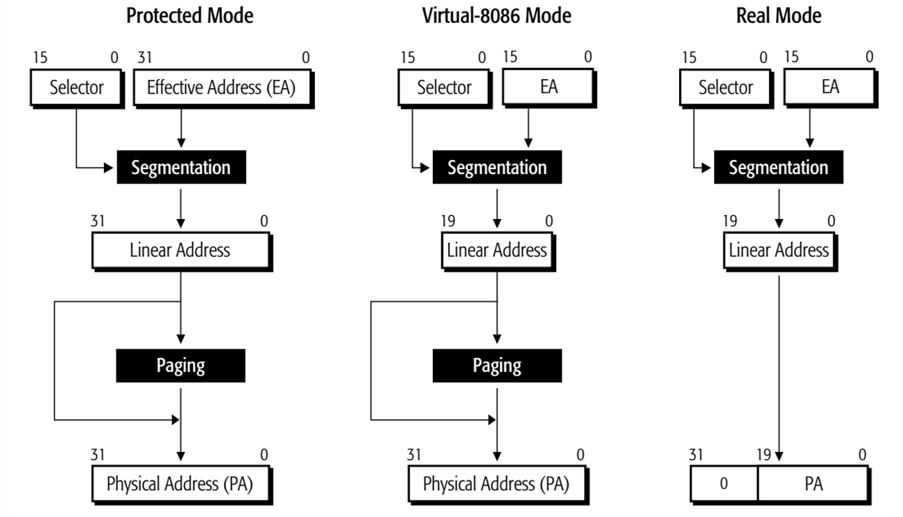{ width="90%" }
  <figcaption>左：Legacy mode 地址转换</figcaption>
</figure>

<figure markdown>
  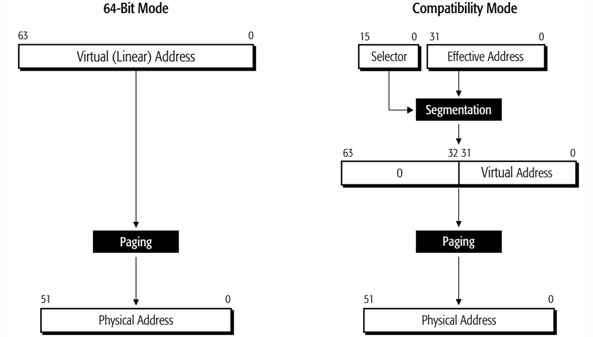{ width="90%" }
  <figcaption>右：Long mode 地址转换</figcaption>
</figure>

</div>

有四个 address 术语，需要区分一下：

- **有效地址**（Effective Address）： 数据在当前段内的偏移量，也叫段偏移，计算方式为【Base + Index × Scale + Displacement】；
- **逻辑地址**（Logical Address）： 指定“使用哪个段，以及段内哪个位置”，形如【段选择子 : 有效地址】；
- **线性地址**（Linear Address）： 分段转换后得到的地址，也通常称为虚拟地址，计算方式为【段基址 + 有效地址】；
- **物理地址**（Physical Address）： 最终访问实际物理内存的位置，线性地址经过页表转换得到。

x86 之所以存在多种 mode，原因在处理器演化过程中【寄存器位宽】、【内存大小】与【内存管理方式】出现变化。寄存器位宽从 16 bit, 32 bit 到 64 bit, 内存转换使用 segmentation 到 paging, 从没有保护措施到特权级检查/访问权限检查。区分不同 mode 的根本就在于这些方面。

| 一级模式 | 二级模式 | 可运行程序 | 分段机制 | 分页机制 | 保护机制 |
|---|---|---|---|---|---|
| Legacy Mode | Real Mode | 16 位实模式程序 | 实模式分段：segment × 16 + offset | 不支持 | 不支持特权级和内存保护 |
| Legacy Mode | Protected Mode | 16 位或 32 位程序 | 通过选择子查询段描述符 | 可选 | 支持特权级、段界限和访问权限检查 |
| Legacy Mode | Virtual-8086 Mode | 传统 16 位实模式程序 | 使用类似实模式的分段方式 | 可选 | 在保护模式控制下提供有限保护 |
| Long Mode | 64-bit Mode | 64 位程序 | 大部分分段功能被弱化，`FS/GS` 仍可使用 | 必须 | 主要通过分页和特权级实现保护 |
| Long Mode | Compatibility Mode | 旧的 16 位或 32 位保护模式程序 | 保留保护模式的分段语义 | 必须 | 在 64 位操作系统控制下运行 |

关于 segmentation 与 paging，在此不展开。

-----

<br>

### 2.1 Read Mode Memory Addressing

实模式（Real Mode）采用【段地址 + 偏移地址】的方式访问内存，逻辑地址写作 `Segment:Offset`，对应的地址计算公式为【线性地址 = ( 段寄存器值 << 4 ) + 偏移量】。段寄存器和偏移量都是 16 位，因此每个段最多覆盖 64 KiB，并且段起点按 16 字节对齐。

<figure markdown id="fig-dsmem">
  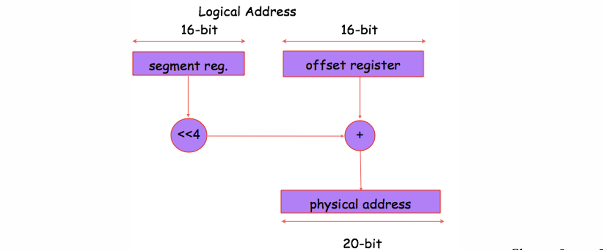{ width="500" }
  <figcaption>实模式寻址方式</figcaption>
</figure>

处理器取指令时默认使用 CS:IP，普通数据访问通常使用 DS:Offset，栈操作使用 SS:SP，通过 BP 访问栈数据时也默认使用 SS. 段可以看作覆盖在内存上的窗口，不同段能够分离、相接或重叠，因此同一个物理地址可能对应多个逻辑地址。段能 overlap 的根本原因是，CS 只要求 16 字节对齐，而非 64 KiB 字节对齐。

8086/8088/80186 只有 20 根地址线，最多直接表示 1 MiB 物理内存；当段地址计算结果超过 `0xFFFFF` 时，最高位会被丢弃并从地址 0 开始回绕，例如 `F800:8000` 得到线性地址 `0x100000`，但实际物理地址为 `0x00000`。80286 及后续处理器拥有更多地址线，不会天然回绕，因此使用 A20 Gate 控制第 20 位地址线，从 20 位地址扩展到 24 位地址，以兼容依赖回绕行为的旧软件。

程序主要使用段内偏移，只要操作系统或加载器修改段寄存器，就可以把程序装入不同的内存位置，而不必修改程序内部的偏移地址，从而实现简单的重定位。

-----

<br>

### 2.2 Protected Mode Addressing

保护模式的主要目的，是突破实模式只能方便访问低端 1 MiB 内存的限制，并提供内存保护、权限控制和任务隔离。在保护模式下，段寄存器不再直接保存段基址，而是保存一个称为**段选择子（Segment Selector）**的值。处理器使用选择子在描述符表中找到对应的段描述符，再从描述符中取得段的基址、长度和访问权限。即【段选择子 $\rightarrow$ 段描述符 $\rightarrow$ 段基址 $\rightarrow$ Linear Address】的寻址逻辑。

**段选择子**

段选择子是一个 16 位值，保存在 CS、DS、ES、SS、FS、GS 等段寄存器中：

<figure markdown id="fig-dsmem">
  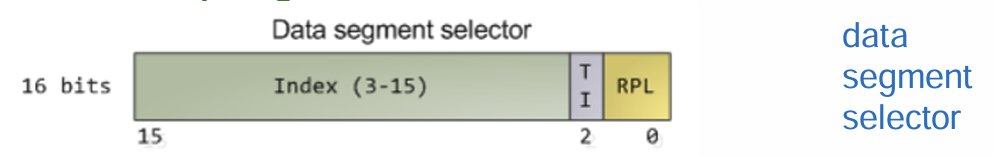{ width="500" }
  <figcaption>data segment selector</figcaption>
</figure>

其中，Index 指定描述符表中的第几项，因为每个描述符占 8 字节，所以描述符地址约为【描述符表基址 + Index × 8】；TI = 0 表示查询 GDT，TI = 1 表示查询当前 LDT；RPL 表示请求特权级，取值为 0～3，数值越小，权限越高。

**描述符与描述符表**

<div class="grid" markdown>

<figure markdown>
  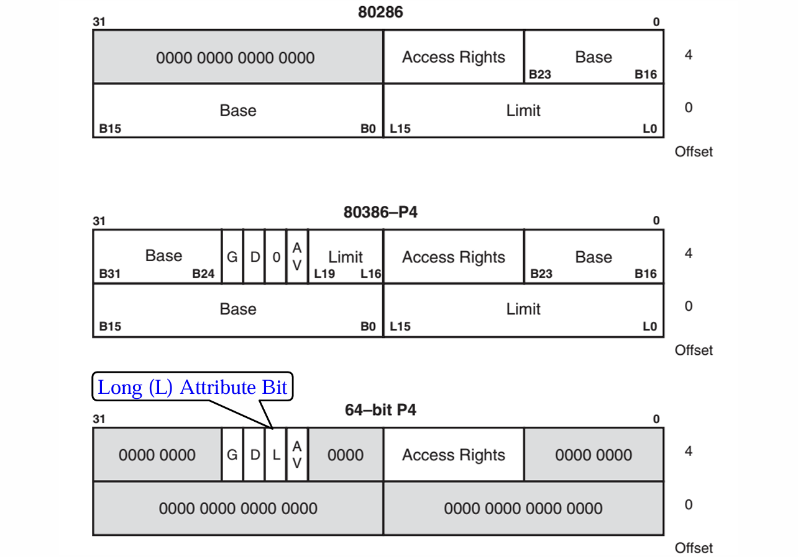{ width="80%" }
  <figcaption>左：各代描述符</figcaption>
</figure>

<figure markdown>
  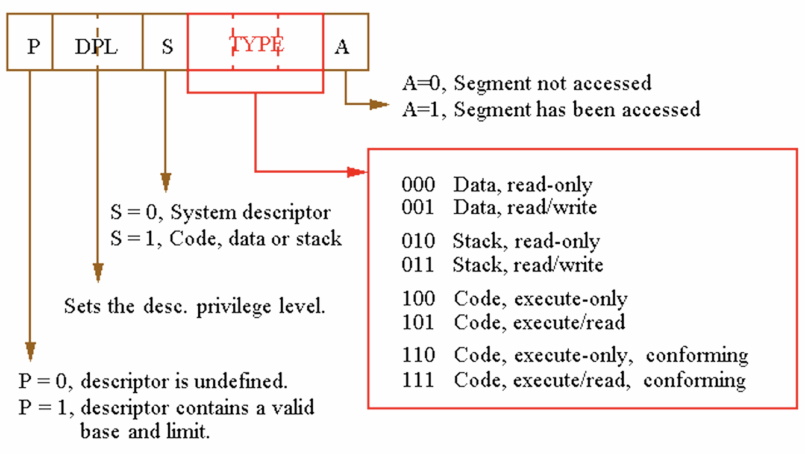{ width="100%" }
  <figcaption>右：Access Rights</figcaption>
</figure>

</div>

一个段描述符占 8 字节，用于描述一个内存段的属性，主要包含段基址 Base、段界限 Limit、段类型、读写或执行权限、特权级以及存在位等信息。

- GDT（Global Descriptor Table）保存整个系统共享的描述符，是保护模式必需的；
- LDT（Local Descriptor Table）保存某个任务或程序专用的描述符，是可选的；
- IDT（Interrupt Descriptor Table）保存中断门、陷阱门等门描述符，用于处理中断和异常。

GDT 的第 0 项必须是全零的空描述符，空选择子可以装入 DS、ES、FS 或 GS，但使用它访问内存时会产生 #GP 异常。

从各代描述符的设计也可以发现，80286 的 Base 拼起来共 24 位，表明其 linear address space 大小是 16 MiB; 80386 到 早期 Pentium4 的 Base 拼起来是 32 位，表明其 linear address space 大小是 4 GiB. 而由于后期 Pentium4 使用 64 位模式放弃了传统的【段基址 + 段界限】寻址，只保留描述符的模式选择和权限检查功能；地址空间的划分与保护主要交给分页机制完成，所多数位为 0. 而描述符表就是存放描述符的数组。

??? note "关于 Segment Limit 与 G 位"
    保护模式下，描述符中的 Base 表示段的起始地址，20 位的 Limit 表示段内允许访问的最大偏移量。段的实际大小为【Limit + 1】，段的结束地址（闭区间）为【Base + Limit】.

    粒度位 G 决定 Limit 的单位：

    | G 位| Limit 的单位 | 实际界限 | 段大小 |
    |---|---|---|---|
    | G = 0 | 字节 | Limit | ( Limit + 1 ) 字节 |
    | G = 1 | 4 KiB | (Limit << 12) \| 0xFFF | ( ( Limit + 1) << 12 ) 字节  |

    比如，G = 0 的题目:

    <figure markdown id="fig-dsmem">
    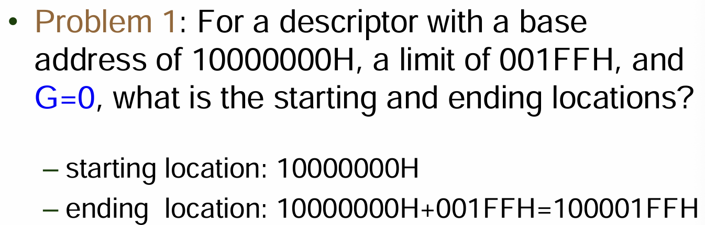{ width="500" }
    <figcaption>G = 0, no scale</figcaption>
    </figure>

    比如，G = 1 的题目:

    <figure markdown id="fig-dsmem">
    { width="500" }
    <figcaption>G = 1, 4 KiB scale, question</figcaption>
    </figure>

    <figure markdown id="fig-dsmem">
    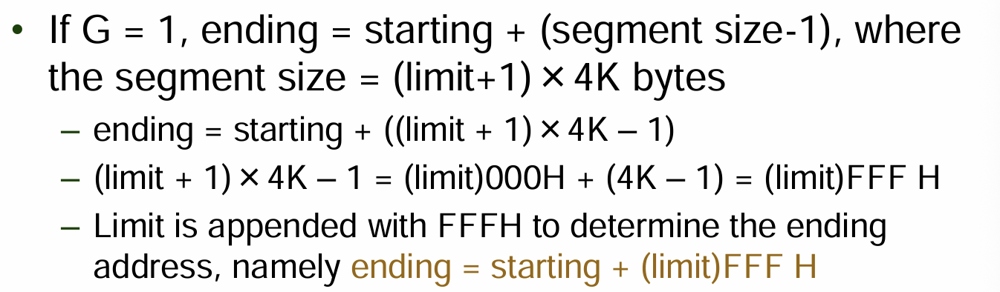{ width="500" }
    <figcaption>G = 1, 4 KiB scale, answer</figcaption>
    </figure>

    注意计算。


**四类 invisible 寄存器**

| 寄存器 | 全称 | 直接保存的内容 | 指向/定位的结构 | 主要作用 |
|---|---|---|---|---|
| `GDTR` | Global Descriptor Table Register | GDT 的基址和界限 | GDT 基地址 | 定位全局描述符表 |
| `IDTR` | Interrupt Descriptor Table Register | IDT 的基址和界限 | IDT 基地址 | 定位中断描述符表 |
| `LDTR` | Local Descriptor Table Register | 指向 LDT 描述符的选择子 | GDT 中的某一 LDT 描述符 | 定位当前任务使用的 LDT |
| `TR` | Task Register | 指向 TSS 描述符的选择子 | GDT 中的某一 TSS 描述符 | 定位当前任务的任务状态段 TSS |

所以 LDTR 本质上也是一种 selector，至于访存时是否使用 LDTR，取决于段选择子的 TI 位。

-------

<br><br><br><br><br><br><br><br>
<br><br><br><br><br><br><br><br>
<br><br><br><br><br><br><br><br>
<br><br><br><br><br><br><br><br>
<br><br><br><br><br><br><br><br>
<br><br><br><br><br><br><br><br>


## Segmentation 和 Paging 的主要区别

| 对比项 | Segmentation（分段） | Paging（分页） |
|---|---|---|
| 划分方式 | 将内存划分为大小可变的段 | 将内存划分为大小固定的页和页框 |
| 大小决定者 | 段的大小由用户或程序指定 | 页和页框的大小由硬件体系结构规定 |
| 内存碎片 | 容易产生外部碎片 | 容易产生内部碎片 |
| 管理结构 | 使用段表，记录段标识、段基址、段界限和权限等信息 | 使用页表，记录虚拟页对应的物理页框以及页面状态 |
| 地址转换 | 通过段表将逻辑地址转换为线性地址 | 通过页表将线性地址转换为物理地址 |
| 查找速度 | 课件认为段表查找通常较快 | 多级页表查找相对较慢，但可以通过 TLB 加速 |
| 主要使用者 | 更接近用户或编译器看到的程序结构 | 主要由操作系统和 MMU 管理 |

### 默认段选择规则

| 有效地址中使用的寄存器 | 默认段 |
|---|---|
| `BX, SI, DI` | `DS` |
| `BP, SP` | `SS` |
| `EBX, ESI, EDI` | `DS` |
| `EBP, ESP` | `SS` |

## Segment and Offset Addressing Allows Relocation

### 可重定位程序与数据

| 概念 | 含义 |
|---|---|
| Relocatable Program（可重定位程序） | 程序可以被加载到内存中的任意位置，并且无须修改即可执行。 |
| Relocatable Data（可重定位数据） | 数据可以被放置在内存中的任意位置，而程序无须因此发生改变。 |

分段寻址为什么支持重定位？程序主要使用相对于段起始位置的偏移地址。移动整个程序时，只需要修改段寄存器，程序内部的偏移地址可以保持不变。

在 x86 保护模式中，Gate（门）是一种特殊的描述符。普通段描述符用于描述一段代码或数据所在的位置、大小和访问权限，而 Gate 描述符用于描述一个受保护的程序入口，其中包含目标代码段选择子、入口偏移地址、特权级和 Gate 类型等信息。当程序通过 Gate 进入中断处理程序、系统过程或其他特权代码时，CPU 会先进行权限检查，只有满足条件才允许跳转，必要时还会完成特权级和栈的切换。常见类型包括调用门、任务门、中断门和陷阱门。因此，段描述符描述的是一块内存区域，而 Gate 描述符描述的是进入特定代码的受控入口。

8086 -> 16-bit
80286 -> 24-bit
80386 -> 32-bit

GDT（全局描述符表）保存整个系统共用的段描述符，在保护模式下必须存在，其基址和界限由 `GDTR` 保存；LDT（局部描述符表）保存某个任务或进程私有的段描述符，是可选的，不同任务可以使用不同的 LDT，当前 LDT 的信息由 `LDTR` 管理。段选择子并不指向整张 GDT 或 LDT 的基址，而是选择表中的某一行描述符：选择子中的 `TI` 位决定使用 GDT（`TI=0`）还是 LDT（`TI=1`），`Index` 字段决定选择第几个描述符，`RPL` 表示请求特权级。描述符地址的计算方式为“描述符表基址 + Index × 8”，其中表基址来自 `GDTR` 或 `LDTR`，乘以 8 是因为每个普通段描述符占 8 字节。

保护模式使用 GDT、LDT 和 IDT 三种描述符表。GDTR 和 IDTR 分别保存 GDT 和 IDT 的基址与界限；LDTR 保存指向 GDT 中 LDT 描述符的选择子；TR 保存指向 GDT 中 TSS 描述符的选择子。


PDE 与 PTE 的 permission configuration 可能不一致

从 Pentium 系列开始，CR4 寄存器作为控制寄存器来管理 paging. CR4 不是一个寄存器，而是一组寄存器，从 CR0 到 CR4

主要为了向后兼容：mode 决定 CPU 当前使用哪一套执行规则，其中最重要的是默认位宽、地址转换方式、分页要求和权限检查方式。不同操作系统只是负责选择和管理这些 CPU 模式。
8086       → Real Mode
80286      → Protected Mode
80386      → 32-bit Protected Mode、Virtual-8086 Mode
x86-64     → Long Mode


<div class="grid" markdown>

<figure markdown>
  { width="100%" }
  <figcaption>左：HBM / L2 Cache 带宽</figcaption>
</figure>

<figure markdown>
  { width="100%" }
  <figcaption>右：L1 Cache / Shared Memory 带宽</figcaption>
</figure>

</div>
