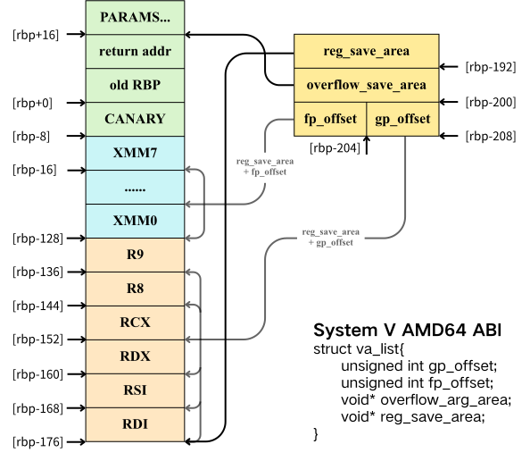
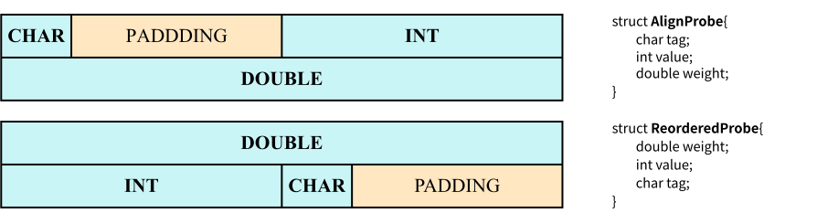

# 高级语言特性在汇编层面的映射

<br><br><br>

本次尝试通过高级语言编程、编译、汇编分析来 uncover 高级语言在汇编语言上的实现，指令集架构包含 x86-32 与 x86-64, 应用程序二进制接口（Application Binary Interface）分析 Microsoft Windows x86 ABI, Microsoft Windows x64 ABI, SystemV AMD64 ABI 三类。研究的问题是：Function Calls and Stack Frames 在不同架构、不同 ABI 下的规范。此外，还结合 C++ 面向对象编程的属性，分析对象的内存布局、多态机制、虚函数调用等问题。

关于 Function Calls 和 Stack Frame 规范，可以提出的问题包含：

1. **ABI 和调用约定如何规定参数与返回值的传递？**包括整数、指针、浮点数、可变参数和结构体如何通过寄存器或栈传递，以及大型结构体返回时隐藏的 sret 指针。
2. **函数栈帧是如何建立、组织和销毁的？**包括函数序言与尾声、rsp 和 rbp 的作用、栈参数、局部变量、spill slot、栈对齐及帧指针省略。此外还有，SystemV red zone、Microsoft shadow space，以及叶函数为什么可能不调整栈指针。
4. **不同架构和 ABI 的调用约定有什么区别？**包括 x86-32 的 cdecl、stdcall、fastcall、thiscall，以及 x86-64 的 SystemV AMD64 和 Microsoft x64 ABI.
5. **C++ 的对象和结构体语义如何体现在汇编中？**包括 this 指针、虚函数表、结构体对齐与 padding、结构体传参与返回，以及拷贝消除。
6. **编译器和优化如何改变函数调用与栈帧？**主要分析 GCC 优化等级、函数内联。

------

<br><br>

## 一、参数传递与结果返回

以下参数传递实验在 [Compiler Explorer](https://godbolt.org/) 中关闭编译优化，使用 [`abi_probe.cpp`](code/abi_probe.cpp)：

| **Compiler Explorer 编译器** | **基本选项** | **ABI** |
| :--- | :--- | :--- |
| x86-64 GCC 16.2 | `-O0 -std=c++17` | System V AMD64 ABI |
| x64 MSVC v19.latest | `/Od /std:c++17` | Microsoft x64 ABI |
| x86 MSVC v19.latest | `/Od /std:c++17` | Microsoft x86 ABI |

### 1.1 总结

| 参数类型 | System V AMD64 ABI | Microsoft x64 ABI | Microsoft x86 ABI（默认 `__cdecl`） |
|---|---|---|---|
| 整数、指针 | 依次使用寄存器 RDI, RSI, RDX, RCX, R8, R9 | 按参数位置使用 RCX, RDX, R8, R9 | 不使用寄存器传参，从右向左压栈 |
| 浮点、双精度 | 依次使用寄存器 XMM0～XMM7 | 按参数位置使用 XMM0～XMM3 | 通过栈传递 |
| 寄存器容纳不下的参数 | 放到栈上 | 放到 32-byte shadow space 以上的栈区域 | 原本就在栈上 |
| 结构体 | 先按 eightbyte 分类；部分不超过 16 字节的结构体可使用寄存器，其余放栈 | 1、2、4、8 字节的简单结构体可像整数一样传递；其他大小通常通过隐藏指针传递 | 按值复制到栈上 |
| 可变参数 | 先使用普通参数寄存器；AL 记录使用的向量寄存器数量；更多的参数压栈存储 | 整数、指针参数使用通用寄存器，浮点参数同时占用本位置向量寄存器与通用寄存器，更多的参数压栈存储 | 使用 `__cdecl`，全部放栈并由 caller 清理 |


这里的“按参数位置使用”是 Microsoft x64 ABI 的特殊说法：先给从左到右的前四个参数编号 1 $\sim$ 4，再根据每个参数的类型选择该编号对应的寄存器。第 1 $\sim$ 4 个位置分别对应 RCX/RDX/R8/R9（整数、指针）或 XMM0/XMM1/XMM2/XMM3（浮点）。它不是指“整数参数单独从 RCX 开始计数、浮点参数再从 XMM0 重新计数”。

这里的“溢出到栈”是指 **ABI 规定调用者直接在栈上传递参数**，这个与编译器的 register spill 不是一个问题。后者指的是，关闭编译优化后，被调用者经常主动把已经通过寄存器传入的参数保存到自己的栈帧中，空出寄存器用于计算；这只是为了方便生成代码，不表示该参数是从栈上传入的。

从一次调用的时间顺序看，参数传递由两方共同完成。caller 先按照被调用函数的类型签名，决定每个参数属于整数类、浮点类还是内存类；随后把能放入寄存器的值装入规定寄存器，把其余值写入规定的栈位置，最后执行 `call`. `call` 指令只负责压入返回地址并跳转，它不会替 caller 自动搬运参数。callee 进入函数后，可以直接使用这些寄存器，也可以把它们保存到自己的栈帧；返回值则按照同一 ABI 放回固定寄存器或调用者提供的内存位置。

------

<br>

### 1.2 整数和指针

指针本质上是一个保存地址的无符号整数，因此它与同位宽整数使用相同的参数寄存器。64 位 ABI 中指针占 8 字节，x86-32 ABI 中指针占 4 字节。

指针的“传参”只复制地址本身，不会自动复制它指向的对象。比如 pointer_arg( ) 的参数只有 8 字节，调用者把对象的地址放入寄存器，callee 再通过一次间接内存访问读取对象。若指针指向的对象很大，传参成本仍主要是一个指针；对象是否可修改，则由 C/C++ 的类型和 const 规则决定。

#### **System V AMD64 ABI**

前六个整数或指针参数依次使用: RDI, RSI, RDX, RCX, R8, R9.

第七个及后续整数参数通过栈传递。integer_overflow( ) 的 Compiler Explorer 输出中，前六个参数来自寄存器，而 g、h 位于调用者栈帧中：

```asm
integer_overflow:
    push rbp
    mov rbp, rsp
    mov DWORD PTR [rbp-4], edi     ; a
    mov DWORD PTR [rbp-8], esi     ; b
    mov DWORD PTR [rbp-12], edx    ; c
    mov DWORD PTR [rbp-16], ecx    ; d
    mov DWORD PTR [rbp-20], r8d    ; e
    mov DWORD PTR [rbp-24], r9d    ; f
    ...
    mov eax, DWORD PTR [rbp+16]    ; g：第 7 个参数在栈上
    mov eax, DWORD PTR [rbp+24]    ; h：第 8 个参数在栈上
```

在函数入口处，[rbp+0] 是压栈的旧 RBP 数值，[rbp+8] 通常是 `call` 压入的返回地址，因此第一个栈参数从更高地址开始。栈参数按 ABI 要求的槽宽和对齐规则排列；不能简单地认为每个 C++ 类型都紧密相邻。对 `int` 而言，g 和 h 分别位于返回地址之后的两个 8 字节槽中，实际值占槽的低 4 字节。

这里的栈空间由 caller 和 callee 分工管理：caller 在执行 `call` 前为第七个及后续参数分配 outgoing argument area，并按 16 字节调用对齐要求调整 RSP；callee 如果还需要局部变量，再在入口处继续下移 RSP 建立自己的栈帧。callee 返回前只释放自己分配的局部区域，执行 `ret` 弹出返回地址；caller 从 `call` 返回后负责恢复本次调用的参数区域。System V AMD64 没有 Microsoft x64 那样固定的 32 字节 shadow space.

单个指针参数进入 RDI. 在 pointer_arg( ) 中，GCC 先将 RDI 保存到 [rbp-8]，再读取它指向的整数：

```asm
mov QWORD PTR [rbp-8], rdi
mov rax, QWORD PTR [rbp-8]
mov eax, DWORD PTR [rax]
```

-----

#### **Microsoft x64 ABI**

前四个整数或指针参数依次使用 RCX, RDX, R8, R9，从第五个参数开始使用栈。调用者无论参数数量多少，都必须预留 32 字节的 **shadow space**，让被调用者在需要时保存四个寄存器参数。注意：这是 caller 必须完成的空间预留，不表示 callee 一进入函数就必须把 RCX/RDX/R8/R9 全部写入内存。下面的布局以被调用函数刚进入时的 RSP 为基准：

```text
| ···      ···                      |   high addr
| [rsp+48] argument6                |
| [rsp+40] argument5                |
| [rsp+8 ... rsp+39] shadow space   |   total 32B
| [rsp] return addr                 |   low addr     
```

因此，这里的“shadow space 之后”指**地址递增方向的更高地址**，不是栈增长方向的更低地址。在 integer_overflow( ) 中，a $\sim$ d 分别来自 ECX, EDX, R8D, R9D，e $\sim$ h 位于 [rsp+40]、[rsp+48]、[rsp+56]、[rsp+64] 等位置。单个指针参数进入 RCX 寄存器。注意 Microsoft x64 的“前四个”是四个**参数位置**，不是整数和浮点各自拥有四个位置。

例如函数：

```cpp
void mixed( int a, double b, int c, double d, int e );
```

它们依次使用 ECX, XMM1, R8D, XMM3, 第五个参数 e 进入栈。XMM0 和 RDX 不会因为空闲而被重新分配给其他参数。所以第一个参数固定选用 RCX/XMM0 作为传参寄存器，第二个参数固定选用 RDX/XMM1 作为传参寄存器，不存在未利用可顺延的规则。


如果 callee 是简单叶函数，只使用寄存器完成计算，它可以完全不使用 shadow space；如果参数需要取地址、函数需要反复读取，或编译器在未优化模式下希望形成稳定的局部变量，就可能把寄存器值写入 [rsp+8]、[rsp+16]、[rsp+24]、[rsp+32]. 因此，Compiler Explorer 中看到的 `mov [rsp+8], ecx` 等指令是编译器实现选择，不是无论是否传参都必须入栈。

Microsoft x64 的栈分配和释放也由 caller、callee 分工完成。caller 在 `call` 前分配 32 字节 shadow space，并为第五个及后续参数追加栈空间；函数调用返回后，caller 恢复这部分 outgoing argument area. callee 如果需要局部变量，可以在序言中执行 `sub rsp, N`，在尾声中执行 `add rsp, N`，自行恢复临时分配的栈空间；`ret` 通常只弹出返回地址，不使用 `ret N` 清理参数。因此，**Microsoft x64 的参数栈空间由 caller 回收，callee 只回收自己的局部栈帧。**


Microsoft x64 的 shadow space 不是普通的局部变量区。它由 caller 在调用前预留，目的是让 callee 可以把 RCX/RDX/R8/R9 保存到固定地址（当然这四个寄存器可能并没有全都用于传参）；第五个参数从这 32 字节之后开始。caller 还要在调用过程中维持栈的 16 字节对齐。

Compiler Explorer 的 x64 MSVC v19.latest（`/Od /std:c++17`）对当前 integer_overflow( ) 给出以下编译产物。该函数没有局部栈空间，因此没有 `sub rsp`。下面的中文行尾注释为阅读时补充：

```asm
a$ = 8,     b$ = 16,    c$ = 24,    d$ = 32
e$ = 40,    f$ = 48,    g$ = 56,    h$ = 64
integer_overflow PROC
    mov     DWORD PTR [rsp+32], r9d             ; d：保存到第 4 个 home slot
    mov     DWORD PTR [rsp+24], r8d             ; c：保存到第 3 个 home slot
    mov     DWORD PTR [rsp+16], edx             ; b：保存到第 2 个 home slot
    mov     DWORD PTR [rsp+8], ecx              ; a：保存到第 1 个 home slot
    mov     eax, DWORD PTR b$[rsp]              ; b$ = 16，读回 b
    mov     ecx, DWORD PTR a$[rsp]              ; a$ = 8，读回 a
    add     ecx, eax                            ; ECX = a + b
    mov     eax, ecx                            ; EAX 保存当前和
    add     eax, DWORD PTR c$[rsp]              ; c$ = 24
    add     eax, DWORD PTR d$[rsp]              ; d$ = 32
    add     eax, DWORD PTR e$[rsp]              ; e$ = 40，第 5 个参数来自栈
    add     eax, DWORD PTR f$[rsp]
    add     eax, DWORD PTR g$[rsp]
    add     eax, DWORD PTR h$[rsp]
    ret     0                                   ; 不清理 caller 的参数区
integer_overflow ENDP
```

MSVC 把偏移量先定义为符号，再在指令中使用，例如 `b$[rsp]` 等于 `[rsp+16]`，`e$[rsp]` 等于 `[rsp+40]`。不会运行时查找变量名，在汇编阶段汇编器会把符号替换成数值偏移。上述数值以 callee 刚进入、尚未调整 RSP 时为基准；前四个是 home slot，e $\sim$ h 是栈参数。

------

#### **Microsoft x86 ABI**

默认的 __cdecl 将所有参数从右向左压栈，调用完成后由 caller 恢复 ESP. __stdcall 同样通过栈传参，但由 callee 使用 `ret N` 清理参数，恢复 ESP.

在 Compiler Explorer 的 x86 MSVC v19.latest（`/Od /std:c++17`）中，同一个 abi_probe.cpp 的 integer_args( ) 与 stdcall_args( ) 尾声分别为：

```asm
_integer_args PROC
    push    ebp
    mov     ebp, esp
    ...
    pop     ebp
    ret     0               ; __cdecl：只弹返回地址
_integer_args ENDP

_stdcall_args@12 PROC
    push    ebp
    mov     ebp, esp
    ...
    pop     ebp
    ret     12              ; __stdcall：再弹出 12 B 参数
_stdcall_args@12 ENDP
```

省略号表示两段函数各自的算术指令；`ret 0` 不清除参数，`ret 12` 清除三个 4 B 栈参数。

另外两种常见约定具有特殊寄存器规则：

- __fastcall：前两个适合放入寄存器的 32 位或更小参数使用 ECX 与 EDX，其余参数从右向左压栈；
- __thiscall：非静态成员函数的隐式 this 指针通常使用 ECX，显式参数通过栈传递。

fastcall_args( ) 与 Object::add( ) 分别展示寄存器参数及 this 指针。它们分别来自 abi_probe.cpp、object_probe.cpp，均使用 x86 MSVC v19.latest 的 `/Od /std:c++17`：

fastcall_args( ) 入口时由 ECX、EDX 分别传入 a、b. 下面的 `_a$`、`_b$` 则是 MSVC 为两者保存的**局部栈槽偏移**，不是寄存器的别名；`_c$ = 8` 是原本就通过栈传入的 c.

```asm
_a$ = -8
_b$ = -4
_c$ = 8
@fastcall_args@12 PROC
    push    ebp
    mov     ebp, esp
    sub     esp, 8                      ; 为 a、b 的局部副本留空间
    mov     DWORD PTR _b$[ebp], edx     ; b 原本由 EDX 传入
    mov     DWORD PTR _a$[ebp], ecx     ; a 原本由 ECX 传入
    mov     eax, DWORD PTR _b$[ebp]
    mov     ecx, DWORD PTR _a$[ebp]
    lea     eax, DWORD PTR [ecx+eax*2]
    imul    edx, DWORD PTR _c$[ebp], 3  ; c 是栈参数
    add     eax, edx
    mov     esp, ebp
    pop     ebp
    ret     4                           ; callee 清理栈上的 c
@fastcall_args@12 ENDP

_this$ = -4
_x$ = 8
int Object::add(int) PROC
    push    ebp
    mov     ebp, esp
    push    ecx                         ; 为 this 的局部副本留空间
    mov     DWORD PTR _this$[ebp], ecx  ; ECX 传入 this
    mov     eax, DWORD PTR _this$[ebp]
    mov     eax, DWORD PTR [eax]        ; 读取 this -> value
    add     eax, DWORD PTR _x$[ebp]     ; x 是栈参数
    mov     esp, ebp
    pop     ebp
    ret     4                           ; callee 清理 x
int Object::add(int) ENDP
```

__fastcall 的名称修饰形式和 `ret N` 的具体字节数会随参数类型变化；__thiscall 的 this 指针不占用栈槽，因此第一个显式参数仍从 EBP 加 8 开始。

在 x86-32 中，caller 和 callee 对 ESP 的看法必须完全一致。__cdecl 由 caller 清理参数，因此可以支持数量不固定的参数；__stdcall 由 callee 按固定字节数清理，适合固定参数列表；__fastcall 只是把少量整数参数提前放入 ECX/EDX，其余参数仍从右向左入栈。函数名修饰和 `ret N` 会把参数大小与清栈责任直接暴露在汇编中。我们可以通过汇编代码直接判断 stack management 的权责。

-----

<br>

### 1.3 浮点参数

浮点参数不能占用一般的通用寄存器传参，需要使用向量寄存器 XMM0-XMM15 或者 stack 传参。

#### **System V AMD64 ABI**

标量 float 和 double 依次使用 XMM0 $\sim$ XMM7. 第九个及后续浮点参数进入栈。在十参数探针函数 floating_overflow( ) 中：

```asm
movsd QWORD PTR [rbp-8], xmm0     ; a 先压栈，空出寄存器
movsd QWORD PTR [rbp-16], xmm1    ; b 先压栈，空出寄存器
...
movsd QWORD PTR [rbp-64], xmm7    ; h 先压栈，空出寄存器
...
addsd xmm0, QWORD PTR [rbp+16]    ; i：第 9 个参数在栈上
addsd xmm0, QWORD PTR [rbp+24]    ; j：第 10 个参数在栈上
```

整数寄存器和 XMM 寄存器是两套独立的分配序列。混合参数中，整数参数消耗通用寄存器，浮点参数消耗 XMM 寄存器；最终是否进入栈取决于相应类别的寄存器是否已经用完。所以理想情况下，SystemV AMD64 ABI 规范下，函数通过寄存器传递参数数量的上限为 $6+8=14$ 个。这意味着“第九个浮点参数进栈”只针对浮点寄存器序列，并不要求前面已经没有整数寄存器。一个函数可以同时使用 RDI 传递整数、XMM0 传递第一个 double；caller 分别维护两类寄存器的使用计数。

-----

#### **Microsoft x64 ABI**

前四个参数位置若是浮点类型，分别使用 XMM0～XMM3. 第五个及后续位置无论是整数还是浮点，都通过栈传递。因此 floating_overflow( ) 只有 a $\sim$ d 从 XMM 寄存器传入，e $\sim$ j 均位于栈上。空出的寄存器不会被后面的参数填补。若第二个参数是整数，第二个位置消耗 RDX；即使 XMM1 空闲，第三个浮点参数仍然对应第三个位置，使用 XMM2. 这种设计使 callee 能够仅依据参数序号和静态类型确定取值位置。

Compiler Explorer 的 x64 MSVC v19.latest（`/Od /std:c++17`）对 floating_overflow( ) 输出如下。MSVC 的符号定义 `a$ = 8`、`b$ = 16`、……、`e$ = 40`：

```asm
floating_overflow PROC
    movsd   QWORD PTR [rsp+32], xmm3 ; d 保存到 home slot
    movsd   QWORD PTR [rsp+24], xmm2 ; c 保存到 home slot
    movsd   QWORD PTR [rsp+16], xmm1 ; b 保存到 home slot
    movsd   QWORD PTR [rsp+8], xmm0  ; a 保存到 home slot
    movsd   xmm0, QWORD PTR a$[rsp]
    addsd   xmm0, QWORD PTR b$[rsp]
    addsd   xmm0, QWORD PTR c$[rsp]
    addsd   xmm0, QWORD PTR d$[rsp]
    addsd   xmm0, QWORD PTR e$[rsp] ; e$ = 40，直接读取栈参数
    ...
    ret     0
floating_overflow ENDP
```

省略号略去 f～j 的连续加法。a～d 先从 XMM0～XMM3 保存到 home slot；e 从入口时的 `[rsp+40]` 读取，它原本就在栈上。

-----

#### **Microsoft x86 ABI**

普通 __cdecl、__stdcall 和 __fastcall 调用中的浮点参数均通过栈传递。虽然函数内部可以用 XMM 指令计算，但这不表示参数是通过 XMM 寄存器传入的。本实验中 MSVC 的函数序言先执行 `push ebp`、`mov ebp, esp`，此后栈布局为：EBP 加 0 是旧的 EBP，EBP 加 4 是 `call` 压入的返回地址，EBP 加 8 是第一个参数。由于 double 占 8 字节，后续 double 参数位于 EBP 加 16、EBP 加 24 等位置。

同一个 floating_overflow( ) 在 x86 MSVC v19.latest 的 `/Od /std:c++17` 输出中，从 `_a$ = 8`、`_b$ = 16` 开始连续读取栈参数：

```asm
_floating_overflow PROC
    push    ebp
    mov     ebp, esp
    sub     esp, 8                      ; 为中间结果留局部空间
    movsd   xmm0, QWORD PTR _a$[ebp]    ; a 位于 [ EBP + 8 ]
    addsd   xmm0, QWORD PTR _b$[ebp]    ; b 位于 [ EBP + 16 ]
    addsd   xmm0, QWORD PTR _c$[ebp]
    ...
    mov     esp, ebp
    pop     ebp
    ret     0
_floating_overflow ENDP
```

double 虽然在函数内部被装入 XMM0 计算，但它进入函数时仍然来自栈，而不是由 caller 放入 XMM 寄存器。

----

<br>

### 1.4 结构体参数

结构体不能只按“一个参数”处理。ABI 会根据其大小、成员类型和对齐方式，决定拆分到寄存器、整体放到栈上，还是改为传递指向临时副本的隐藏指针。

这里的“按值传递”是高级语言层面的描述，不等于机器层面一定复制全部字节。编译器可以把小结构体拆成若干机器字并分别放入寄存器，也可以先在 caller 栈帧低地址部分的临时区域构造完整副本，再只传递副本地址。callee 不能只根据源代码中的 `struct` 关键字猜测传递方式，必须依据目标 ABI 的分类规则查看汇编。

实验使用四种结构体测试：

```cpp
struct Small { int x; int y; };                                 /* 8 B */
struct Pair  { long long x; long long y; };                     /* 16 B */
struct Large { long long x; long long y; long long z; };        /* 24 B */
struct Huge  { long long x; long long y;
               long long z; long long w; };                     /* 32 B */
```

Compiler Explorer 的结果为：

| 结构体 | System V AMD64 ABI | Microsoft x64 ABI | Microsoft x86 ABI |
|---|---|---|---|
| Small，8B | 整体放入 RDI 寄存器 | 整体放入 RCX 寄存器 | 复制 8 字节到栈上 |
| Pair，16B | 拆为两个 eightbyte，使用 RDI, RSI | caller 创建副本，将副本地址放入 RCX | 复制 16 字节到栈上 |
| Large，24B | 按值复制到栈上 | caller 创建副本，将副本地址放入 RCX | 复制 24 字节到栈上 |
| Huge，32B | 按值复制到栈上 | caller 创建副本，将副本地址放入 RCX | 复制 32 字节到栈上 |

-----

#### **System V AMD64 ABI**

System V AMD64 将结构体划分为最多两个 8 字节块，再把每个块分类为 INTEGER、SSE 等类别。能够完成寄存器分类且总大小不超过两个 eightbyte 的结构体，可以通过通用寄存器、XMM 寄存器或二者组合传递；分类结果为 MEMORY 或通常大于 16 字节时，则通过栈传递。

这里的分类可以理解为“先把结构体切成机器能够处理的 8 字节块，再决定每个块应该放在哪一类寄存器”。INTEGER 表示该块主要由整数、指针或整数填充组成，使用通用寄存器；SSE 表示该块由 float、double 等浮点数据组成，使用 XMM 寄存器；MEMORY 表示这个参数不能按寄存器块传递，caller 必须把它放到栈上。完整 ABI 还定义了其他类别，但本实验的整数和 double 结构体主要会遇到 INTEGER、SSE 和 MEMORY.

例如：

```cpp
struct Pair  { long long x; long long y; }; /* INTEGER + INTEGER */
struct DPair { double x; double y; };       /* SSE + SSE */
struct Mixed { long long x; double y; };    /* INTEGER + SSE */
```

在 System V AMD64 下，Pair 的两个块可以分别使用 RDI、RSI；DPair 的两个块可以分别使用 XMM0、XMM1；Mixed 的第一个块使用 RDI，第二个块使用 XMM0. 也就是说，结构体参数并不一定“整体只占一个寄存器”，而是可能按 8 字节块分散到通用寄存器和 XMM 寄存器中。

分类完成后还要检查寄存器是否够用。如果结构体需要两个 INTEGER 块，但当时只剩一个通用寄存器，整个结构体通常会退回 MEMORY 并放到栈上，而不是让一半走寄存器、一半走栈。结构体未按 8 字节对齐、包含不适合寄存器传递的成员，或者大小超过两个 eightbyte（通常超过 16 字节）时，也会得到 MEMORY 分类。

分类是递归进行的：先从结构体的最外层开始，按照成员的偏移量把成员放入连续的 8 字节块；如果成员本身是嵌套结构体，就先递归分类嵌套结构体，再把得到的类别放回外层对应的块中。每个成员先产生自己的类别：整数、字符、指针属于 INTEGER，float、double 属于 SSE.

随后只合并位于同一个 eightbyte 内的类别，不会把不同 eightbyte 的类别混在一起。空块的初始类别可以看成“尚未分类”；放入第一个成员后采用该成员的类别，继续放入其他成员时按以下直观规则处理：同为 INTEGER 仍是 INTEGER，同为 SSE 仍是 SSE，INTEGER 和 SSE 出现在同一块时按 INTEGER 处理。因此，一个块最终只有一个类别；两个块则分别得到两个类别。

例如：

```cpp
struct CharInt   { char c; int i; };            /* 一个 8B 块：INTEGER + INTEGER -> INTEGER */
struct Mixed8    { int x; float y; };           /* 一个 8B 块：INTEGER + SSE -> INTEGER */
struct Mixed16   { long long x; double y; };    /* 两个 8B 块：INTEGER、SSE */
```

CharInt 的 char 和 int 都落在第一个 eightbyte 中，合并后得到一个 `INTEGER`；Mixed8 的 int 和 float 也落在同一个块中，合并后仍得到一个 `INTEGER`；Mixed16 的 long long 和 double 分别位于两个块，因此不发生跨块合并，最终得到 `INTEGER`、`SSE` 两个类别。完成分类后，才根据这些类别选择通用寄存器或 XMM 寄存器。

例如，`Pair` 的两个成员分别进入 RDI 和 RSI了，进入函数内直接从寄存器读取数据：

```asm
mov rax, rdi
mov rcx, rsi
mov QWORD PTR [rbp-16], rax             ; 保存第一个 8-byte 到栈帧
mov QWORD PTR [rbp-8], rcx              ; 保存第二个 8-byte 到栈帧
```

Large 则直接从 [rbp+16]、[rbp+24]、[rbp+32] 读取三个成员，说明整个结构体由 caller 复制到了栈上。

------

#### **Microsoft x64 ABI**

Microsoft x64 不会把一个参数拆到多个寄存器中。1、2、4、8 字节的简单聚合类型可以像同宽整数一样占用一个参数寄存器；其他大小通常统一由 caller 创建按值副本，并把副本地址作为一个整数参数传入。因此 Pair 和 Large 的源码虽然是按值传递，汇编中看到的却是 RCX 中的地址。这个隐藏指针指向副本，不等同于把源码参数改成按引用传递，因为修改副本不会影响源结构体，这与引用的语义是相悖的。

因此，在 Microsoft x64 汇编中看到 RCX 指向一块内存，并不表示源代码声明了 `T&`. 对于按值结构体，caller 仍负责构造副本，callee 只能访问这份副本；只有结合函数声明、调用点和 ABI 规范，才能区分显式引用参数和 ABI 为大结构体生成的间接传参。

------

#### **Microsoft x86 ABI:**

Microsoft x86 更为直接，把结构体的完整按值副本放到栈上。结构体越大，占用的连续栈空间越多。

为了确保结构体继续增大不会出现新的行为，新增的测试 Huge 结构体为 32 B. Compiler Explorer 的 GCC 16.2 输出从 RBP 加 16、RBP 加 24、RBP 加 32、RBP 加 40 读取四个成员，说明它整体位于栈上；x64 MSVC 仍然只在 RCX 中接收副本地址，再从该地址的偏移 0、8、16、24 读取成员；x86 MSVC 则从 EBP 加 8 开始读取连续的 32 字节按值副本。由此可见，Large 和 Huge 都已经超过 System V AMD64 的两个 eightbyte 寄存器分类上限，继续增大结构体不会产生“部分寄存器、部分栈”的混合传递。

------

<br>

### 1.5 可变参数

可变参数在调用点没有完整的静态类型列表，因此 ABI 还必须提供让 callee 找到匿名参数的方法。需要注意 C/C++ 的默认参数提升：float 会提升为 double，char 和 short 会提升为 int.

普通函数可以依靠函数原型知道每个参数的类型和位置，而 `va_arg` 面对的是一串没有名字的参数。为此，ABI 要么让 callee 保存所有可能的寄存器参数，要么规定 caller 把参数统一放入可遍历的栈区域。这也是 x86-32 可变参数函数必须使用 `__cdecl` 的根本原因。

调用者不会额外传递一个“参数总数”。可变参数的数量必须由接口约定确定，例如由固定的 count 参数、printf 风格的格式字符串，或者 nullptr 等结束标记确定；va_list 本身不能自动判断参数何时结束。

接收方通常按 `va_start`、`va_arg`、`va_end` 的顺序使用参数：`va_start` 根据最后一个固定参数初始化读取状态；`va_arg` 按指定类型取出下一个匿名参数，并推进对应的读取位置；`va_end` 结束这次读取。通过 `...` 传递的 char、short 已提升为 int，float 已提升为 double，所以读取时必须使用提升后的类型，例如传入 char 后要用 `va_arg( arguments, int )`，不能用 `va_arg( arguments, char )`.

#### **System V AMD64 ABI**

具名参数和匿名参数仍按普通规则使用六个整数寄存器和八个 XMM 寄存器，超出的部分进入栈。调用者还要在 AL 中给出本次调用使用的向量寄存器数量上界。

对于 `variadic_sink( "%f", value )`，格式串地址进入 RDI，double 进入 XMM0，同时设置 EAX = 1：

```asm
movq xmm0, rax
mov edi, OFFSET FLAT:.LC0           ; EDI 传入格式串地址
mov eax, 1                          ; XMM 寄存器使用上限
call variadic_sink
```

callee 的 va_list 同时维护通用寄存器偏移、浮点寄存器偏移、寄存器保存区地址和栈参数地址，因此 `va_arg` 可以依次从寄存器保存区或栈中取值。va_list 数据结构的拆解及各段含义如下图所示：

<figure markdown id="fig-dsmem">
  { width="500" }
  <figcaption>SystemV AMD64 ABI 变长参数管理</figcaption>
</figure>

在 GCC 的 x86-64 System V 实现中，va_list 的核心字段可以写成：

```cpp
struct va_list_impl {
    unsigned int gp_offset;          /* 通用寄存器保存区的当前偏移 */
    unsigned int fp_offset;          /* XMM 保存区的当前偏移 */
    void* overflow_arg_area;         /* 寄存器参数用完后的栈参数起始位置 */
    void* reg_save_area;             /* 寄存器保存区起始地址 */
};
```

实际的 `va_list` 通常是这个结构的特殊数组类型。reg_save_area 是固定的起始地址，不会随着读取移动；读取整数或指针时推进 gp_offset，读取浮点数时推进 fp_offset，寄存器槽位用完后则推进 overflow_arg_area. 函数序言中看到的 `mov` 保存 RDI、RSI、RDX、RCX、R8、R9（图中橙色部分）以及 `movaps` 保存 XMM0 $\sim$ XMM7（图中蓝色部分），就是在建立这些保存区。固定参数已经占用的寄存器槽位可以不实际保存，但逻辑上的偏移仍然会经过它。

AL 不是匿名参数的数量，而是本次调用使用过的 XMM 寄存器数量上界。读取参数时，如果对应偏移仍在寄存器保存区范围内，`va_arg` 从保存区取值；否则才沿着 overflow_arg_area 读取栈参数。

这里的“向量寄存器数量”特指 ABI 用来传递标量浮点参数的 XMM 寄存器数量，不是处理器中向量寄存器的总数。x86-64 基本寄存器组通常有 XMM0 $\sim$ XMM15 共 16 个 128 位 XMM 寄存器；启用 AVX 后，同一组寄存器可作为 256 位 YMM0 $\sim$ YMM15 使用；支持 AVX-512 的处理器还提供 ZMM0 $\sim$ ZMM31 共 32 个 512 位寄存器。System V AMD64 ABI 只把 XMM0 $\sim$ XMM7 作为前八个标量浮点参数寄存器，Microsoft x64 ABI 甚至只使用前四个参数位置对应的 XMM0 $\sim$ XMM3. 因此 AL = 1 的含义是“本次调用使用了一个 XMM 参数寄存器”，而不是“系统只有一个向量寄存器”。

------

#### **Microsoft x64 ABI**

可变参数仍遵守 Microsoft x64 的“四个位置槽”规则：把固定参数和匿名参数放在同一条参数序列中编号，第 1 $\sim$ 4 个位置分别对应 RCX、RDX、R8、R9，同时也对应 XMM0 $\sim$ XMM3；第 5 个及之后的位置通过栈传递。这里的“位置”不是“匿名参数自己的编号”，而是包含固定参数后的总编号。例如格式串占第 1 个位置时，后面的第一个匿名参数就是第 2 个位置，使用 RDX 或 XMM1 寄存器。

对于普通的、参数类型已由函数原型确定的浮点参数，通常只需使用对应的 XMM 寄存器；但可变参数函数的匿名浮点参数没有静态类型列表，调用者必须把同一个值同时放入对应的 XMM 寄存器和通用寄存器。这样 callee 即使只按通用寄存器保存区处理匿名参数，也仍能取得这个值。整数或指针参数不需要复制，直接使用对应的通用寄存器。

本例中格式串是第一个参数，使用 RCX；第二个位置的匿名 double 同时放入 XMM1 和 RDX：

```asm
movsd xmm1, QWORD PTR value$[rsp]           ; 放入 xmm1
movq rdx, xmm1                              ; 放入 rdx
lea rcx, OFFSET FLAT:format_string          ; 格式串传入
call variadic_sink
```

------

#### **Microsoft x86 ABI**

可变参数函数使用 `__cdecl`：参数从右向左放入栈中，并由 caller 清栈。double 占 8 字节，格式串指针占 4 字节，因此调用后执行 `add esp, 12`：

```asm
movsd QWORD PTR [esp], xmm0                 ; 匿名参数压栈
push OFFSET format_string                   ; 格式串地址压栈
call _variadic_sink
add esp, 12                                 ; 16 字节对齐
```

-----

<br>

### 1.6 结构体返回值

结构体返回值不能简单套用“整数放 RAX、浮点数放 XMM0”的规则，ABI 会先根据结构体大小和成员类别决定是直接返回，还是使用隐藏的 sret（structure return）指针。sret 指针指向调用者预先准备好的结果对象存储区；callee 把返回的结构体写入这块区域，调用者随后从该地址继续使用结果。

#### **System V AMD64 ABI**

能够按不超过两个 eightbyte 完成分类的小结构体，通常直接沿用结构体参数的分类结果返回：INTEGER 块使用 RAX、RDX，SSE 块使用 XMM0、XMM1，混合结构体可以同时使用通用寄存器和 XMM 寄存器。例如两个整数成员的 Pair 可以从 RAX 和 RDX 返回，两个 double 成员的 DPair 可以从 XMM0 和 XMM1 返回。分类为 MEMORY 或通常超过 16 字节的结构体使用隐藏 sret 指针；在这种情况下，调用者把结果地址放入 RDI，源代码中的显式参数从 RSI 开始使用，callee 写入 RDI 指向的区域。

本实验中的小结构体返回函数是：

```cpp
extern "C" NOINLINE Pair make_pair( long long x, long long y ){
    return { x + 1, y + 2 };
}
```

在 System V AMD64 下，x 和 y 仍分别位于 RDI、RSI，返回值的两个 eightbyte 分别放入 RAX、RDX（其中结构体低地址 8 字节在 RAX 中返回，结构体高地址 8 字节在 RDX 中返回）. 若返回类型换成 24 B 的 Large，调用者会额外准备结果缓冲区，并把地址放入 RDI；callee 改为写入该地址：

```asm
lea  rdi, [rbp-32]          # 调用者的结果缓冲区
mov  rsi, 10                # 传入第一个显式参数
mov  rdx, 20                # 传入第二个显式参数
call make_large             # [rbp-32] 开始的内存就是返回的 Large
```

-----

#### **Microsoft x64 ABI**

1、2、4、8 字节的简单结构体通常可以像同宽整数一样直接从 RAX 返回；其他结构体通常使用隐藏 sret 指针。调用者先分配结果对象，再把结果地址作为隐藏的第一个参数放入 RCX，源代码中的第一个显式参数顺延到 RDX. callee 通过 RCX 写入完整结构体，通常还会在 RAX 中返回这个结果地址，便于调用者继续处理。

例如返回 16 B 的 Pair 时，MSVC 使用间接返回：

```asm
lea  rcx, [rsp+20h]         ; caller 分配的 Pair 临时对象地址
mov  rdx, 10                ; 传入第一个显式参数
mov  r8,  20                ; 传入第二个显式参数
call make_pair              ; callee 把两个成员写入 [rcx] 和 [rcx+8]
```

-----

#### **Microsoft x86 ABI**

简单的小结构体可以按 MSVC 的返回寄存器规则直接返回；较大的结构体通常由调用者分配结果缓冲区，并把隐藏结果地址作为额外的栈参数传给 callee. callee 将结构体复制到该地址，调用者负责在调用结束后使用并管理这块存储。由于隐藏指针也占用一个栈参数位置，分析 x86 汇编时必须先确认它是否存在，再判断源代码显式参数对应的 EBP 加 8、EBP 加 12 等偏移。

典型的 x86 间接返回形态可以抽象为：

```asm
; [ebp+8]  = 隐藏的结果缓冲区地址
; [ebp+12] = 第一个显式参数
mov  eax, DWORD PTR [ebp+8]
mov  DWORD PTR [eax],  ...      # 写入返回结构体的低 8 byte
mov  DWORD PTR [eax+4], ...     # 写入返回结构体的高 8 byte
```

------

<br>

所以，综上来看，一次调用的 stack 可以同时包含寄存器参数、shadow space、溢出栈参数、结构体临时副本和返回地址。参数进入栈主要有四种情况：

1. **参数寄存器已经用完**：System V AMD64 的第七个整数或第九个浮点参数，Microsoft x64 的第五个参数位置；
2. **ABI 强制该类型使用内存**：例如 System V AMD64 中分类为 `MEMORY` 的结构体；
3. **结构体不能装入一个 Microsoft x64 参数寄存器**：caller 创建副本并通过寄存器或栈传递其地址；
4. **目标 ABI 默认通过栈传参**：例如 Microsoft x86 的 `__cdecl` 和 `__stdcall`.

------

<br><br>


## 二、函数栈帧布局

使用 code/stack_frame_probe.cpp 中的 frame_probe( )、call_make_large( )、make_large( ) 和 make_huge( ) 观察栈帧。编译器统一使用未优化选项：GCC 16.2 使用 `-O0 -std=c++17`，MSVC 使用 `/Od /std:c++17`. 在没有优化的情况下才可以看到最基础的、最完整的 ABI 规范。

### 2.1 测试对象与观察顺序

每个测试都从调用点和被调用函数两侧观察，不能只看 callee 的局部汇编。先看 caller 是否分配参数区、shadow space 或 sret 缓冲区；再看 `call` 压入的返回地址；然后看 callee 的函数序言如何保存旧 RBP/EBP、调整 RSP/ESP；最后区分局部变量、寄存器保存副本和 spill slot、red zone 相关区域。

| 测试函数 | 主要观察对象 |
| :--- | :--- |
| frame_probe( ) | 栈参数、局部变量、数组、寄存器参数保存副本 |
| integer_overflow( ) | 参数寄存器耗尽后的 caller 栈参数 |
| make_large( )、make_huge( ) | 大结构体返回的 sret 缓冲区和隐藏参数 |
| call_make_large( ) | caller 如何准备返回缓冲区并恢复栈空间 |
| red_zone_probe( ) | leaf 函数是否使用 System V AMD64 red zone |

关于函数 **frame_probe( ):**

```cpp
int frame_probe( int a, int b, int c, int d, int e, int f, int g ){
    volatile int local_a = a + b;
    volatile int local_b = c + d;
    volatile long long local_c = static_cast< long long >( e ) + f;
    char local_bytes[ 32 ]{ };    
    local_bytes[ 0 ] = static_cast< char >( g );
    escape( local_bytes );
    return local_a + local_b + static_cast< int >( local_c ) + local_bytes[ 0 ];
}
```

这个函数故意同时制造四类对象：g 是最后一个 ABI 栈参数，local_a、local_b、local_c 是局部变量，local_bytes 是局部数组，传给 escape( ) 的地址会阻止编译器把数组完全消除。各自的定位作用是：

1. 在 caller 中标记变量 g 的写入位置（入栈地址）；它发生在 `call frame_probe` 之前，属于 caller 的 outgoing argument area 上界（地址最高处）。
2. 在 callee 序言中可以发现 `push rbp`、`mov rbp, rsp` 和 `sub rsp, N`，以此确定当前帧的边界（上界由 RBP 确定，下界由 RSP 确定。
3. 在 calle 中可以发现类似 `mov DWORD PTR [rbp-...] , edi` 的指令。这是把寄存器参数复制到 callee 局部区域，不是 caller 的栈传参，是 register spill 到 stack 中。
4. 找到对 `[rbp-...]` 的加法、数组写入和传给 escape( ) 的地址，分别对应局部变量和数组的位置。
5. 如果编译器把某个中间结果先写入 `[rbp-...]`、随后又加载回寄存器，这个槽位是 spill slot，不是新的参数。

**关于 integer_overflow( ):**

```cpp
extern "C" NOINLINE int integer_overflow(
    int a, int b, int c, int d, int e, int f, int g, int h ){
    return a + b + c + d + e + f + g + h;
}
```

在 System V AMD64 中，caller 把第七、八个整数参数写入 outgoing argument area；`call` 只额外压入返回地址。callee 建立 RBP 后，栈参数位于返回地址和旧 RBP 的高地址一侧。Microsoft x64 中，caller 先分配 32 B shadow space，再把第五个及后续参数放到更高地址；callee 不能把 shadow space 当成第五个参数。这个测试应同时打开 caller 和 callee 的汇编，才能区分 caller 压入 stack 的参数、callee 的 shadow space 以及 callee 自己的 stack frame.

**关于 make_large( ):**

```cpp
Large call_make_large( long long value ){
    return make_large( value, value + 1, value + 2 );
}
```

对于 call_make_large( )，最终返回对象的 sret 缓冲区必须由它的 caller 提供，因此不属于 call_make_large( ) 自己的栈帧。call_make_large( ) 调用 make_large( ) 时，通常可以把同一个结果地址继续向下传递；如果编译器没有进行这种地址转发，也可能在 call_make_large( ) 的栈帧中临时分配另一块区域，这块临时区域不是最终的 sret 缓冲区调用，make_large( ) 结束后还要再把结果复制到上层 caller 提供的最终缓冲区。判断时应查看每次调用的隐藏结果地址：谁分配并持有该地址，谁就是对应结果对象的存储提供方；callee 只负责通过收到的地址写入结构体。

-----

<br>

### 2.2 栈帧中各区域的来源

一次调用的内存区域各部分分配方式与具体功能各不相同：

| 区域 | 由谁准备 | 作用 |
| :--- | :--- | :--- |
| 返回地址 | `call` 指令 | 保存 callee 返回后继续执行的位置 |
| 旧 RBP/EBP | callee 序言 | 保存调用者的帧指针；`push rbp` 后位于当前 RBP 加 0 |
| 栈参数 | caller | 寄存器参数用完后的参数，或 ABI 强制使用内存的参数 |
| shadow space | Microsoft x64 caller | 为 RCX、RDX、R8、R9 对应的四个位置预留 32 B |
| 局部变量 | callee | 源代码中的局部对象、数组和临时对象 |
| 寄存器保存副本 | callee | 将寄存器传入的参数或可变参数寄存器保存区写入栈帧 |
| spill slot | callee/compiler | 寄存器不够时暂存中间值 |
| sret 结果缓冲区 | caller | 大结构体返回时由 caller 提供 |

-----

<br>

### 2.3 System V AMD64 的典型布局

System V AMD64 的栈帧要从 caller 执行 `call` 之前开始观察。以 integer_overflow( ) 为例，前六个整数参数先放入 RDI、RSI、RDX、RCX、R8、R9，caller 再为第七、第八个参数预留 outgoing argument area，并按 16 B 调用对齐调整 RSP. 第七、第八个参数在 `call` 之前就已经属于 caller 准备的栈参数，callee 不负责把它们压入自己的栈帧。

执行 `call` 后，硬件只把下一条指令的地址压入栈顶并跳转到 callee. 进入 callee 的瞬间，RSP 指向返回地址；返回地址之上是 caller 的栈参数。若 callee 使用帧指针并执行：

```asm
push rbp
mov  rbp, rsp
sub  rsp, N
```

对应的典型尾声是：

```asm
add  rsp, N
pop  rbp
ret
```

也可以用一条 `leave` 代替 `mov rsp, rbp` 和 `pop rbp`：

```asm
leave
ret
```

则进入稳定帧后通常有：

```text
...
[rbp+24]  第二个栈参数（例如第八个整数参数）
[rbp+16]  第一个栈参数（例如第七个整数参数）
[rbp+8]   返回地址
[rbp+0]   旧 RBP
[rbp-...] callee 的局部变量、保存副本和 spill slot
```

`[rbp+16]` 这个偏移来自返回地址 8 B 加旧 RBP 8 B. 如果省略 `push rbp` 或省略帧指针，不能直接套用这些偏移，而应从进入函数时的 RSP 和每条 `sub/add rsp` 指令重新计算。callee 执行 `sub rsp, N` 后，RSP 以下的区域属于自己的局部变量、寄存器保存副本和 spill slots. 即为:

```text
... high address
┌───────────────────────────────┐
│ arg7, arg8 ...                │ caller 压入 stack 的参数区
├───────────────────────────────┤
│ return addr                   │ call 压入 stack 的 返回地址
├───────────────────────────────┤
│ old RBP                       │ push rbp 压入
├───────────────────────────────┤ <- RBP
│ 保存寄存器参数/寄存器副本         │ callee 选择性建立
│ local var, array, spill slots │ callee 的栈帧
└───────────────────────────────┘ <- RSP( 无 red zone 时 )
... low address
```

对于 make_large( ) 这种大结构体返回函数，sret 地址占用第一个整数参数位置 RDI，源代码参数从 RSI 开始；结果对象本身由 caller 在自己的栈帧中分配，callee 只通过 RDI 写入它。若看到 callee 内部把 RDI 保存到 `[rbp-...]`，那是保存指针副本，不是又分配了一份返回结构体。

------

<br>

### 2.4 Microsoft x64 的典型布局

Microsoft x64 的返回地址位于进入函数时 RSP 指向的位置；其上方是 caller 预留的 32 B shadow space，再往高地址才是第五个及之后的栈参数。callee 的局部变量和保存副本位于下移后的 RSP 以下。大结构体返回时，sret 地址占用 RCX，源代码第一个显式参数从 RDX 开始。

MSVC x64 通常不使用 `push rbp` 建立固定帧指针，而是直接调整 RSP：

```asm
sub  rsp, N
...
add  rsp, N
ret
```

如果编译器启用帧指针，也可能出现 `push rbp`、`mov rbp, rsp`，但 shadow space 和栈参数的位置仍遵循 Microsoft x64 ABI 规范。

```text
... high address
┌──────────────────────────────┐
│ arg6, arg5 ....              │ caller 参数区
├──────────────────────────────┤
│ shadow space 32 B            │ RCX/RDX/R8/R9 的 home slots
├──────────────────────────────┤
│ return addr                  │ [RSP]（进入 callee 时）
├──────────────────────────────┤ <- 进入时 RSP
│ local var、保存寄存器副本、spill│ callee 执行 sub rsp 后形成
└──────────────────────────────┘
... low address
```

frame_probe( ) 同时包含七个整数参数、多个 volatile 局部变量和 32 B 数组。观察其 MSVC 输出时，应把第五个参数之后的位置认作 caller 栈参数，把 `[rbp-...]` 的局部区域认作 callee 栈帧；不要把 shadow space 误认为已经传入的第五个参数。

-----

<br>

### 2.5 Microsoft x86 的典型布局

以 `push ebp`、`mov ebp, esp` 建立帧指针后，EBP 加 0 是旧 EBP，EBP 加 4 是返回地址，EBP 加 8 开始是参数，注意 32 位架构下指针都是 4 字节的。`__cdecl` 的参数区由 caller 在返回后清理；`__stdcall` 通常由 callee 使用 `ret N` 一并清理。Microsoft x86 没有 Microsoft x64 的 shadow space，浮点参数和结构体均直接用 stack 传递。

典型的 Microsoft x86 序言和尾声是：

```asm
push ebp
mov  ebp, esp
sub  esp, N
...
mov  esp, ebp
pop  ebp
ret
```

`__stdcall` 的 callee 可能改用 `ret N`，其中 N 是需要由 callee 一并弹出的参数字节数。

```text
... high address
┌──────────────────────────────┐
│ other args                   │ EBP+...
├──────────────────────────────┤
│ arg0 / hidden sret ptr       │ EBP+8
├──────────────────────────────┤
│ return addr                  │ EBP+4
├──────────────────────────────┤
│ old EBP                      │ EBP+0
├──────────────────────────────┤ <- EBP
│ local var, reg copy, spill   │ EBP-...
└──────────────────────────────┘
... low address
```

make_large( )、make_huge( ) 在 x86 输出中可用来确认隐藏 sret 指针使显式参数整体向后移动；frame_probe( ) 则用来区分参数区、返回地址、旧 EBP 和 callee 的局部区域。

-----

<br>

### 2.6 red zone 与栈对齐

red zone 是 System V AMD64 ABI 一条特有的规范。

System V AMD64 在 RSP 以下保留 128 B red zone. 叶子函数（不再调用其他函数的函数）可以直接把临时数据放在这 128 B 内，而不执行 `sub rsp, N`；正常的信号处理和中断处理不会破坏这块区域。red zone 位于当前 RSP 的低地址方向，不属于 caller 的栈参数区，也不包含返回地址。只要函数执行了 `call`，新的调用可能使用这片区域，因此不能把仍需保留的数据放在 red zone 中后再调用其他函数，故称为**叶子函数**。

Microsoft x64 ABI 没有 red zone，RSP 以下的地址不能被 callee 当作保留空间使用；Windows 的异步异常、调试器或其他代码可能直接覆盖那里。因此同一个 leaf 函数在 GCC System V 和 MSVC x64 下可能出现不同序言：GCC 在函数局部变量很少时不会调整 RSP，而 MSVC 在任何情况下均必须为局部数组执行 `sub rsp, N`.

可以用 red_zone_probe( ) 观察这一差异。本项目保持 `-O0 -fno-stack-protector`，再增加 `-mno-red-zone` 编译一次，比较函数序言和尾声。未优化时，GCC 通常已经建立 RBP 帧指针；允许 red zone 的版本可能省略 `sub rsp, N`，而禁止 red zone 的版本会显式分配局部数组空间。

以 x86-64 编译器在遵守 System V AMD64 ABI 的实际输出为例，两次编译的关键差异如下：

```asm
# -O0 -fno-stack-protector：允许使用 red zone
red_zone_probe:
    push rbp
    mov  rbp, rsp                   ; 无显示 sub rsp, N
    mov  byte ptr [rbp-112], 0
    movaps xmmword ptr [rbp-96], xmm0
    ...
    movzx ecx, byte ptr [rbp-112]
    movzx eax, byte ptr [rbp-17]
    add  eax, ecx
    pop  rbp
    ret

# -O0 -fno-stack-protector -mno-red-zone：禁止 red zone
red_zone_probe:
    push rbp
    mov  rbp, rsp
    sub  rsp, 112                   ; 存在显式 sub rsp, N
    mov  byte ptr [rbp-112], 0
    movaps xmmword ptr [rbp-96], xmm0
    ...
    movzx ecx, byte ptr [rbp-112]
    movzx eax, byte ptr [rbp-17]
    add  eax, ecx
    add  rsp, 112                   ; 显式恢复
    pop  rbp
    ret
```

两份代码完成的计算相同，区别在于局部数组是否使用 RBP 以下、但未通过 `sub rsp` 显式分配的区域。第一份建立 RBP 后不调整 RSP，局部数据落在 red zone；第二份执行 `sub rsp, 112`，局部数据落在 callee 明确分配的栈帧中，返回前通过 `add rsp, 112` 恢复。

```text
System V AMD64（可能的 leaf 函数）
... high address
│ return addr               │ [rsp]
├───────────────────────────┤
│ red zone, total 128 B     │ [rsp-128, rsp)
│ temporal data             │
... low address

Microsoft x64
... high address
│ return addr               │ [rsp]
├───────────────────────────┤
│ unallocated, forbidden    │
... low address
```

此外，RSP 必须在 ABI 要求的边界上对齐：System V AMD64 通常要求执行 `call` 前按 16 B 对齐，Microsoft x64 也要求函数调用边界满足 16 B 对齐。`push`、`sub rsp, N`、保存返回地址都会改变对齐关系，可以发现其会通过 `sub rsp, N` 来维护 16B 对齐关系的。

-----

<br><br>

## 三、C++ 对象和结构体语义

本题使用 code/object_probe.cpp，按“对象布局 $\rightarrow$ 传参 $\rightarrow$ 成员函数 $\rightarrow$ this 指针 $\rightarrow$ 虚函数”的顺序观察 C++ 语义如何落到内存和汇编。同一个 probe 文件可以直接切换 Compiler Explorer 的目标编译器和架构：GCC 16.2 使用 `-O0 -std=c++17`，MSVC 使用 `/Od /std:c++17`.

### 3.1 结构体对齐与 padding

每个成员通常从满足自身对齐要求的下一个偏移开始；成员之间因为对齐产生的空洞就是 padding. 结构体的整体大小还要向其最大成员对齐值取整，以便连续数组中的每个元素都满足同样的对齐。

```cpp
struct AlignProbe {
    char tag;               /* offset 0，占 1B */
    int value;              /* 从 offset 4 开始，中间有 3B padding */
    double weight;          /* 从 offset 8 开始，占 8B */
};
```

在常见 x86-64 ABI 下，AlignProbe 的布局通常是：

```text
offset 0       tag       1 B
offset 1..3    padding   3 B
offset 4..7    value     4 B
offset 8..15   weight    8 B
sizeof = 16, alignof = 8
```

ReorderedProbe 将较大对齐要求的 double 放在前面，可以消除成员之间的 padding；但结构体末尾仍可能产生尾部 padding，因此总大小未必改变。因此，不能简单根据成员大小相加判断 sizeof( ).

<figure markdown id="fig-dsmem">
  { width="500" }
  <figcaption>AlignProbe 与 ReorderedProbe 内存布局</figcaption>
</figure>


Compiler Explorer 的 GCC 16.2（`-O0 -std=c++17 -masm=intel`）在 by_pointer( ) 中实际通过以下指令访问 AlignProbe 成员：

```asm
mov     rax, QWORD PTR [rbp-8]    ; 取回对象地址
mov     edx, DWORD PTR [rax+4]    ; value 字段位于对象偏移 4
mov     rax, QWORD PTR [rbp-8]
movsd   xmm0, QWORD PTR [rax+8]   ; weight 字段位于对象偏移 8
```

这里的 +4 和 +8 是成员在对象内的偏移，不是参数在栈帧中的偏移。

-----

<br>

### 3.2 结构体的传值与传引用

下面是测试的不同类型的函数传参：

```cpp
extern "C" NOINLINE int by_value( AlignProbe value );
extern "C" NOINLINE int by_pointer( const AlignProbe* value );
extern "C" NOINLINE int by_reference( const AlignProbe& value );
```

按值传递表示 callee 得到一个独立的对象副本。副本可能被 ABI 拆到寄存器，也可能由 caller 复制到栈上或临时区域（传一个隐形指针，前面已经讨论过），显然 callee 对 value 成员的修改不会改变 caller 的原对象，符合高级语言的语义。指针传递只复制参数的地址，callee 通过一次间接内存访问读取对象，可以跨函数修改；引用在机器层面通常也表现为地址传递，但源代码语义要求它绑定到一个有效对象，不能为 NULL.

在汇编中区分三者时，我认为应看是否出现对象字节复制：by_value( ) 的入口可能直接读取多个寄存器/栈槽；by_pointer( ) 和 by_reference( ) 通常先从一个寄存器取得地址，再使用类似 `mov eax, DWORD PTR [rdi+4]` 的间接访问。但是很难在汇编的层面区分出传指针与传引用。

Compiler Explorer 的 GCC 16.2（`-O0 -std=c++17 -masm=intel`）给出的三个函数关键指令为：

```asm
"by_value":
    mov     rax, rdi                    ; 第 1 个 eightbyte：整数类
    movq    rdx, xmm0                   ; 第 2 个 eightbyte：SSE 类
    mov     QWORD PTR [rbp-16], rax     ; 保存第 1 块到本地副本
    mov     QWORD PTR [rbp-8], rdx      ; 保存第 2 块到本地副本
    mov     edx, DWORD PTR [rbp-12]     ; 读取副本中的 value
    movsd   xmm0, QWORD PTR [rbp-8]     ; 读取副本中的 weight

"by_pointer":
    mov     QWORD PTR [rbp-8], rdi
    mov     rax, QWORD PTR [rbp-8]
    mov     edx, DWORD PTR [rax+4]      ; 通过指针读取 value
    mov     rax, QWORD PTR [rbp-8]
    movsd   xmm0, QWORD PTR [rax+8]     ; 通过指针读取 weight

"by_reference":
    mov     QWORD PTR [rbp-8], rdi      ; 引用同样以地址形式传入
    mov     rax, QWORD PTR [rbp-8]
    mov     edx, DWORD PTR [rax+4]
    mov     rax, QWORD PTR [rbp-8]
    movsd   xmm0, QWORD PTR [rax+8]
```

以上仅摘取与传参及成员读取有关的指令。按值传递时，两个 eightbyte 分别来自 RDI 和 XMM0；指针与引用版本的机器代码在此处相同。两者都通过对象地址加 4、加 8 读取成员，反映的是对象成员偏移。

------

<br>

### 3.3 对象的结构与一般成员函数调用

对象的非静态数据成员按声明顺序嵌入对象内存；普通非静态成员函数的机器代码通常仍是一个独立函数，只是额外接收隐藏的 this 指针。比如 call_member( ) 的源码调用：

```cpp
return object -> add( x );
```

在 System V AMD64 下，this 通常位于 RDI 寄存器，其他参数从 RSI 依次顺延；在 Microsoft x64 下，this 通常位于 RCX 寄存器，其他参数从 RDX 依次顺延。成员函数体访问 value 时，常见形式是：

```asm
; RDI 传入时指向本对象
mov eax, DWORD PTR [rdi]   # 取出本对象的某一个 field 数值
add eax, esi               # 与其他参数做计算
ret
```

成员函数的代码不存放在每个对象内部；对象只保存数据成员，代码地址由链接器和调用约定确定。

此外，this 本身不占用对象存储空间，而只是占用一次参数传递位置；如果成员函数调用另一个成员函数，编译器会继续把同一个对象地址作为下一次调用的隐式参数传递。如果 this 为 null，显然任何通过 this 访问非静态成员的行为都是未定义的。

-----

<br>

### 3.4 对象构造在汇编中的实现

对象构造可以直接发生在函数的局部栈对象上。为了观察 vptr，construct_object( ) 构造含有虚函数的 BaseObject：

```cpp
extern "C" NOINLINE int construct_object( int value ){
    BaseObject object;
    return value + static_cast< int >( sizeof( object ) );
}
```

GCC 16.2 使用 `-O0 -std=c++17 -masm=intel` 时，construct_object( ) 会调用 BaseObject 构造函数，也会在返回前调用析构函数。下面摘取 Compiler Explorer 输出中相关的连续指令：

```asm
"construct_object":
        push    rbp
        mov     rbp, rsp
        push    rbx                         ; 保存 callee-saved RBX
        sub     rsp, 40                     ; 为局部对象等留出栈空间
        mov     DWORD PTR [rbp-36], edi     ; 保存 value 参数
        lea     rax, [rbp-24]               ; 局部 BaseObject 的地址
        mov     rdi, rax                    ; 构造函数的 this 参数
        call    "BaseObject::BaseObject()"  ; 构造局部对象
        ...
        lea     rax, [rbp-24]
        mov     rdi, rax
        call    "BaseObject::~BaseObject()" ; 返回前析构局部对象
        ...
        leave
        ret
```

构造函数本体的关键部分是：

```asm
"BaseObject::BaseObject()":
        push    rbp
        mov     rbp, rsp
        mov     QWORD PTR [rbp-8], rdi                  ; 保存 this 地址
        mov     edx, OFFSET FLAT:"_ZTV10BaseObject"+16  ; 虚表 address point
        mov     rax, QWORD PTR [rbp-8]                  ; 取回 this
        mov     QWORD PTR [rax], rdx                    ; 写入对象起始处的 vptr
        nop
        pop     rbp
        ret
```

这里 `"BaseObject::BaseObject()"` 是 Compiler Explorer 的反修饰显示，`_ZTV10BaseObject` 是同一输出中的 GCC 虚表符号。BaseObject 构造函数把 vtable 地址写入对象起始位置，表明虚函数表指针通常位于对象内存空间的开头 8 个字节；DerivedObject 的 `-O0` 构造则先调用 BaseObject 构造函数，再写入 DerivedObject 的 vptr 和 bias.

GCC 的 vtable 符号通常还包含 offset-to-top、RTTI/typeinfo 等 ABI 元数据，因此对象中的 vptr 指向虚函数地址区域的起始位置，而不一定直接等于 vtable 符号起始地址。汇编中可能看到：

```asm
mov edx, OFFSET FLAT:"_ZTV10BaseObject"+16
```

这里的 +16 是当前 System V AMD64 ABI 布局下跳过元数据的地址偏移。MSVC 使用不同的虚表布局及符号表示，具体写入值见下面的目标编译结果。用相同的 object_probe.cpp 在 Compiler Explorer 切换编译器，BaseObject 构造函数中的实际指令如下（只摘取写入 vptr 的连续指令）：

```asm
; GCC 16.2 x86-64，-O0 -std=c++17 -masm=intel
mov     edx, OFFSET FLAT:"_ZTV10BaseObject"+16          ; 跳过两个 8B 元数据槽
mov     rax, QWORD PTR [rbp-8]
mov     QWORD PTR [rax], rdx                            ; [this] = vptr

; MSVC v19.latest x64，/Od /std:c++17（反修饰显示）
mov     QWORD PTR [rsp+8], rcx                          ; 保存 this
mov     rax, QWORD PTR this$[rsp]                       ; 取回 this
lea     rcx, OFFSET FLAT:const BaseObject::`vftable'    ; 取虚表地址
mov     QWORD PTR [rax], rcx                            ; [this] = vptr

; MSVC v19.latest x86，/Od /std:c++17（反修饰显示）
mov     DWORD PTR _this$[ebp], ecx                      ; 保存 32 位 this
mov     eax, DWORD PTR _this$[ebp]                      ; 取回 this
mov     DWORD PTR [eax], OFFSET const BaseObject::`vftable' ; [this] = vptr
```

GCC 的 +16 来自两个 8 B 元数据槽（offset-to-top 和 RTTI/typeinfo）；MSVC 两个目标均直接使用输出中显示的 vftable 符号，表明在 Microsoft x64/x86 的 ABI 下 VPTR 前面没有其他字段。


-----

<br>

### 3.5 虚函数与虚函数表

虚函数用于实现运行时多态。普通成员函数的目标地址通常在编译期根据表达式的静态类型确定；虚函数则允许基类指针或基类引用在运行时调用派生类覆盖的实现，在运行时查实际【指向】或者【引用】的对象的虚函数表再决定跳转地址：

```cpp
BaseObject* object = new DerivedObject;
object -> transform( 10 );              /* 运行时选择 DerivedObject::transform( ) */
```

这里变量的静态类型是 BaseObject\*，但对象的动态类型是 DerivedObject. 编译器不能只根据 BaseObject* 在编译期确定最终函数地址，因此需要在对象中保存动态类型的入口。通常每个含有虚函数的对象都包含一个隐藏的 vptr，vptr 指向该动态类型对应的 vtable；vtable 中保存虚函数实现的地址。调用虚函数时，程序先从对象读取 vptr，再从 vtable 的相应槽位读取函数地址，最后执行间接调用，并把原对象地址作为 this 传入。

这种机制带来两个直接后果：

- 对象通常比显式数据成员多一个指针大小的 vptr；
- 虚调用至少包含读取 vptr、读取函数指针和一次间接 `call`.

如果编译器能够证明 object 的动态类型，例如 object 实际上是局部的 DerivedObject，优化器可能进行 devirtualization，把虚调用改写为直接调用，甚至进一步内联。相反，通过外部传入的基类指针通常必须保留间接调用。

对 call_virtual( )，典型的间接调用过程是：

```asm
mov  rax, QWORD PTR [rdi]      # 读取对象的 vptr
mov  rax, QWORD PTR [rax]      # 读取第一个虚函数槽
call rax                       # 间接调用 transform( )
```

调用前仍需把 this 放在 RDI（System V AMD64）或 RCX（Microsoft x64），显式参数 x 放在下一个整数参数位置。DerivedObject 的 transform( ) 可以通过 this 读取 bias；因此虚调用包含两次内存读取和一次间接 call，而普通成员函数调用通常可以直接使用静态确定的函数地址。

-----

<br><br>

## 四、优化等级与函数内联

本题使用 code/optimization_probe.cpp，在 Compiler Explorer 中比较 GCC 的 `-O0`、`-O1`、`-O2`、`-O3`. 当前通过 optimization_probe.cpp 中 call_inline( ) 和 loop_with_inline( ) 两个函数，用于观察内联和循环优化。

| 优化等级 | 本实验观察到的结果 |
|:--- |:--- |
| `-O0` | 保留函数调用，并建立完整栈帧；循环变量和 total 累加器显式读写于栈槽 |
| `-O1` | 删除 inline 函数显式调用，形成无栈帧的标量循环 |
| `-O2` | 仍是标量循环，但进一步减少冗余寄存器搬运和栈访问 |
| `-O3` | 将循环向量化为每次处理 4 个 int 的 SSE2 主循环，并生成标量尾循环 |

-----

<br>


### 4.1 函数内联的实现形式

inline 只是允许编译器在调用点展开函数体，不是强制命令。call_inline( ) 调用 inline_add( ) 时，可能保留调用，也可能直接展开。未内联时，调用点类似：

```asm
mov  esi, 3             ; 传入 arg1
mov  edi, eax           ; 传入 arg0
call inline_add         ; 显式调用
```

这里会生成返回地址、执行参数传递，并进入独立的 inline_add( ) 栈帧。内联后，调用点则直接变成：

```asm
lea  eax, [rdi+3]
ret
```

此时没有独立的 inline_add( ) 调用、返回地址或被调用者栈帧，inline_add( ) 的加法计算已经成为 call_inline( ) 的一部分。若使用 `-fno-inline`（GCC/Clang）或 `/Ob0`（MSVC），可以禁止普通内联，再次看到调用指令；`NOINLINE` 则对指定函数强制禁止内联。

loop_with_inline( ) 展示循环内联：在优化开启时，inline_add( ) 的 `a + b` 会直接出现在循环体中；如果进一步开启 `-O3`，编译器还会展开循环或向量化。内联减少了 call、返回地址压栈和调用约定搬运，但会增加 caller 的代码尺寸，引入向量化后汇编代码复杂度明显升高。

-----

<br>

### 4.2 loop_with_inline( ) 在四个等级下的对比

对当前测试函数 `loop_with_inline( )`：
```cpp
for( int i = 0; i < count; ++i )
    total += inline_add( values[ i ], i );          /* total += ( value[ i ] + i ); */
```

各优化选项下的编译结果：

- **-O0：**虽然 inline_add( ) 被声明为 inline，编译器仍生成独立的 `call inline_add( )`. 循环变量、局部变量 total、指针和 count 通常保存在栈帧中，每次迭代都要进行 load/store，并建立完整序言和尾声。inline 只表示允许内联，不表示必须内联。
- **-O1：**inline_add( ) 的函数体通常被展开，循环中不再有 call；数组元素直接从内存读取，total 和 index 主要留在寄存器中。循环仍按一次迭代处理一个 int，通常没有 SIMD 指令。
- **-O2：**在 -O1 的基础上进一步消除冗余寄存器搬运和栈访问；本次 GCC 输出仍是一次处理一个 int 的标量循环，没有 xmm、paddd 或 movdqu 等向量化指令。
- **-O3：**启用循环向量化。GCC 把循环主体改为每次处理 4 个 int 的 SSE2 向量循环，并为不足 4 个元素的尾部生成标量清理代码。

-O0 $\sim$ -O2 的代码不展开，这里主要分析 GCC -O3 中的关键片段：

```asm
movdqu xmm0, XMMWORD PTR [rax]
add    rax, 16                      ; rax 以 4 * 4 = 16B 的 step 步进
paddd  xmm0, xmm2                   ; xmm2 = [ 4k+0, 4k+1, 4k+2, 4k+3 ]
paddd  xmm2, xmm3                   ; xmm3 = [ 4, 4, 4, 4 ]
paddd  xmm1, xmm0                   ; xmm1 is the accumulator
cmp    rax, rdx
jne    .L6
```

这里每个 XMM 寄存器包含四个 32 位整数，一个 `movdqu` 一次读取 4 个数组元素；`paddd` 对四个 lane 同时执行整数加法。xmm2 保存每个向量位置对应的索引增量，即 **[ 4k + 0, 4k + 1, 4k + 2, 4k + 3 ]**. xmm3 由 `movd xmm3, r9d` 和 `pshufd xmm3, xmm3, 0` 构造为 **[ 4, 4, 4, 4 ]**，因此每轮索引向量增加 4. 向量主循环结束后，GCC 使用 `psrldq` 和 `paddd` 将 XMM1 的四个 lane 依次右移、相加，归约成一个标量结果，实际上是一个累加树；如果 count 不是 4 的倍数，再由后面的标量尾循环处理剩余元素。因为 values 指针不保证 16 B 对齐，所以使用 `movdqu` 而不是 `movdqa`.

累加树的形式：

```asm
; xmm0 = [ sum0, sum1, sum2, sum3 ]
; xmm1 = [ sum0, sum1, sum2, sum3 ]
psrldq  xmm0, 8             ; xmm0 = [ 0, 0, sum0, sum1 ]
paddd   xmm1, xmm0          ; xmm1 = [ sum0, sum1, sum0+sum2, sum1+sum3 ]
movdqa  xmm0, xmm1          ; xmm0 = [ sum0, sum1, sum0+sum2, sum1+sum3 ]
psrldq  xmm0, 4             ; xmm0 = [ 0, sum0, sum1, sum0+sum2 ]
paddd   xmm1, xmm0          
; xmm1 = [ sum0, sum0+sum1, sum0+sum1+sum2, sum0+sum1+sum2+sum3 ]
movd    eax, xmm1           ; eax = sum0+sum1+sum2+sum3
```

这也算向量化指令经典的规约计算方式。

-----

<br><br>

## Summary:

本次实验主要在 [Compiler Explorer](https://godbolt.org/)  平台上大量对比高级语言（主要是 C++）与使用不同编译器编译后的汇编代码，充分理解【函数调用】、【栈帧管理】、【结构体与对象的内存布局】、【虚函数调用】等高级语言机制在汇编层面的实现。此外，通过对比 -O0, -O1, -O2, -O3 这些不同的编译选项下的编译产物，感受到现代编译器功能的强大，不过 Compiler 对于我目前而言仍算比较黑盒的内容，应该还需要到下学期才会更加深入理解。在汇编层面分析程序，其清晰度和可靠性是上层编程语言远不能比的。

<br><br>

## 参考资料

- 参数传递与返回：[System V AMD64 psABI](https://gitlab.com/x86-psABIs/x86-64-ABI)、[Microsoft x64 调用约定](https://learn.microsoft.com/en-us/cpp/build/x64-calling-convention?view=msvc-170)
- 栈帧：[Microsoft x64 栈使用规则](https://learn.microsoft.com/en-us/cpp/build/stack-usage?view=msvc-170)
- x86 调用约定：[MSVC 调用约定选项](https://learn.microsoft.com/en-us/cpp/build/reference/gd-gr-gv-gz-calling-convention?view=msvc-170)、[__fastcall](https://learn.microsoft.com/en-us/cpp/cpp/fastcall?view=msvc-170)、[__thiscall](https://learn.microsoft.com/en-us/cpp/cpp/thiscall?view=msvc-170)
- C++ 对象模型：[Itanium C++ ABI](https://itanium-cxx-abi.github.io/cxx-abi/abi.html)
- 栈保护：[GCC 栈保护选项](https://gcc.gnu.org/onlinedocs/gcc/Instrumentation-Options.html)、[MSVC `/GS` 缓冲区安全检查](https://learn.microsoft.com/en-us/cpp/build/reference/gs-buffer-security-check?view=msvc-170)
- 优化与内联：[GCC 优化选项](https://gcc.gnu.org/onlinedocs/gcc/Optimize-Options.html)
