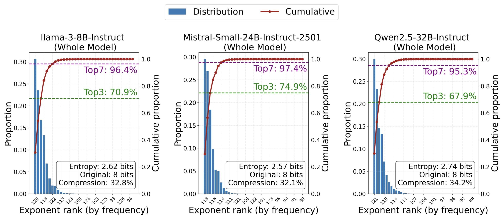
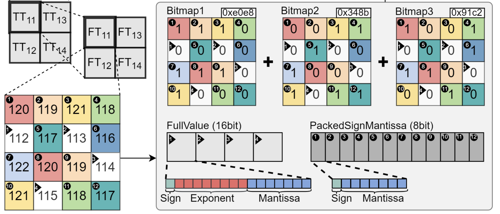
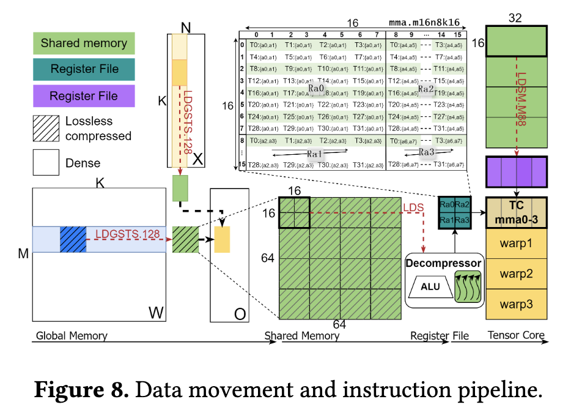
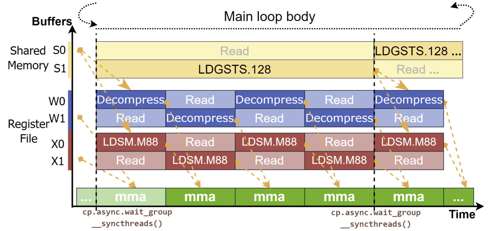

# ZipServ: Fast and Memory-Efficient LLM Inference  with Hardware-Aware Lossless Compression

论文连接：[《ZipServ: Fast and Memory-Efficient LLM Inference  with Hardware-Aware Lossless Compression》](https://arxiv.org/abs/2603.17435)

仓库链接：[ZipServ_ASPLOS26](https://github.com/HPMLL/ZipServ_ASPLOS26)

## Background:

当前模型参数量可达 $\mathrm{TB}$ 级别，有两方面不良影响：其一，权重存储占用空间很大；其二，模型推理时权重加载给带宽造成很大压力。现有的权重压缩主要分为：lossy 有损压缩，lossless 无损压缩。前者通过 quantization 或者 pruning 完成，存在降低模型计算精度的风险；后者通过对某一粒度的权重（一张 matrix? 一块 tile?）做统计分析，依照统计规律以更少的 bit 数编码权重，因为是无损的，故还需要保留部分无法编码的权重的完整格式。因此，前者不需要 decompression，后者需要 decompression.

在 lossless compression 的领域内，原有的压缩方法如 [DFloat11](https://arxiv.org/abs/2504.11651), [DietGPU](https://arxiv.org/abs/2306.12141) 等存在缺陷：

1. 基于 entropy 编码，产生变长的 bitstream. 会有三方面的不利影响：
    - **Bitstream Partitioning:** 为了让多个线程并行处理，需要把压缩比特流切成多个块。但是变长符号可能跨越分块边界，线程无法完全独立地工作，必须依靠额外的元数据来定位合法符号的起始位置。这会增加开销，并破坏规整的并行执行。
    - **Synbol Extraction:** 线程使用分层查找表（LUT）解码符号，这依赖输入数据。当同一 warp 中的线程遇到长度不同的符号时，完成较快的线程必须等待较慢的线程，由此产生线程 divergence 并降低 GPU occupancy. 有负载不均的感觉。
    - **Pointer Advancement:** 解码一个符号后，每个线程都需要按照该符号的编码长度移动比特指针。但符号长度只有在查表解码完成后才能知道。因此，下一次解码依赖上一次解码的结果，使整个解码循环具有 serial dependence，难以利用 ILP.
2. 传统方案的数据流：compressed weight $\rightarrow$ 解压到显存 $\rightarrow$ 加载到 smem $\rightarrow$ 加载到 regs $\rightarrow$ Tensor Core 计算。中间多了一步 decompressed weights 在显存中的完整物化，包含 $M\times K$ 矩阵数据的读取写入各一遍。这对于 memory bound 的推理步骤非常不友好。

为了解决上面的问题，ZIPSERV 的方法就是：

1. 定长编码
2. 解压的数据直接进入 Tensor Core 计算

------

  

## 一、对参数统计规律的观察

ZIPSERV 压缩的数据类型只包含 BF16, 且压缩的是 exponent 段。

$$
\mathrm{BF16}(x) = (−1)^{\mathrm{sign}} × 2^{\mathrm{exponent}−127} × (1.\mathrm{mantissa}).
$$

<figure markdown id="fig-dsmem">
  { width="500" }
  <figcaption>Exponent bit distribution</figcaption>
</figure>

主要观察有两点：

1. exponent 段分布非常 skrewed, TOP-7 的覆盖率可以达到 $95\%$.
2. TOP-7 exponent 在数值上是**连续**的。

第二点原文有证明：若权重矩阵满足 $w \sim \mathcal{N}(0,\sigma^{2}I)$，则 exponent 段在整数域上的概率分布是 unimodal 单峰的，进而满足 TOP-K exponent 数值连续。

------

  

## 二、关键 design

### 2.1 compression 设计

基于前面观察，exponent 的 TOP-7 覆盖率超过 $95\%$ 且数值连续。则针对 exponent 段编码可以很简单，即 "base + offset" 的形式。编码长度固定为 3 bit，除 TOP-7 $\rightarrow$ 001 ~ 111 外，剩余的 000 可以表示数据 fall-back（即 exponent 未落在 TOP-7 范围内，需要完整传输数据以保证 lossless）。基本的方案如下：

<figure markdown id="fig-dsmem">
  { width="500" }
  <figcaption>compression method</figcaption>
</figure>

- base 取参数矩阵 TOP-7 exponent 中的最小值减 1，保证编码后的 3-bit code 可以落在 001 ~ 111 范围内。
- tile 粒度为 $8 \times 8$（图中简化为 $4 \times 4$），compression 后由 5 个 buffer 组成：3 个数据平面的 Bitmap（每一个 Bitmap 都是 64 个参数压缩后同一位上的 bit 值），一个 full-value 数组（未落在 TOP-7 范围内的数据需要保留完整格式），一个 sign-mantissa 数组（落在 TOP-7 范围的数据只拼接 sign 段和 mantissa 段即可）。

按照 $95\%$ 覆盖率计算，理论上压缩后数据宽度期望为：

$$
95\%  \times ( 1 + 3 + 7 ) + ( 1 - 95\% )( 1 + 8 + 7 ) = 11.3~\mathrm{bit} 
$$

所以压缩率大概在 $29.7\%$ 左右。注意，compression 是离线完成的。

-----

 

### 2.2 decompression 设计

ZIPSERV 为避免 decompression 矩阵物化，其参数的数据流为 compressed weight $\rightarrow$ shared memory $\rightarrow$ 寄存器里解压缩 $\rightarrow$ Tensor Core 计算。实际上类似量化矩阵在乘法计算前，分 tile 反量化但不写回 HBM 直接而进入 Tensor Core 做矩阵计算。二者道理是一样的，相当于把解压缩（反量化）与矩阵乘法做 kernel fusion.

<figure markdown id="fig-dsmem">
  { width="500" }
  <figcaption>load compression, compute decompressed</figcaption>
</figure>

假设采用上面的方法，需要考虑一个问题，通常矩阵乘法可以表示为 $C_{M\times N} = A_{M\times K} \times B_{K \times N}$. Tensor Core 在矩阵乘法时对 $N$ 维是有上限限制的，当 $N$ 比较小时，权重矩阵 $A$ 只需要解压缩一次，在一次 Tensor Core 计算中就可以覆盖完 $N$ 维；当 $N$ 比较大时，一次无法遍历完，需要多次 Tensor Core 计算才可覆盖 $N$ 维，意味着 $A$ 矩阵需要被解压缩很多次。前者就是 decode 阶段 memory bound 的情形，后者则是 prefill 阶段 compute bound 的情形。

对于 memory bound 的 case，解压缩与计算融合可以避免 HBM 一遍读写，收益会很明显；对于 compute bound 的 case，重复做解压缩反而会作为一项新的比较大的开销盖过 HBM 读写减少带来的收益，而单纯做一遍 decompressed weights 的 HBM 读写，由于会在 $N$ 维被复用很多次，overhead 会被很好地摊薄。所以 ZIPSERV 选择，在 prefill 阶段仍然用原来 decoupled 的方法，解压缩权重物化到 global memory; 在 decode 阶段采用【解压缩 + 计算】fusion 的方法。不过，无论哪种方案，基于的【压缩-解压缩】算法都是本文提出的定长的 TCA-TBE（Tensor-Core-Aware Triple Bitmap Encoding）.

至于解码，按照编码的方式逆运算即可，不赘述。

在调度方式上，采用双 buffer 交替预取、交替解压缩的方式，使得【数据搬运/解压缩】与【Tensor Core 计算】最大限度地 overlap:

<figure markdown id="fig-dsmem">
  { width="500" }
  <figcaption>fine-grained software pipeline</figcaption>
</figure>

- 在 tile 粒度上（比如 $64\times 64$ 刚好可以喂饱 4 个 warps，做 4 轮迭代），让 producer warp 的数据搬运与 consumer warp 的解压缩以及矩阵计算 overlap. 这是 coarse-grained 的 pipeline，需要用 `cp.async.wait_group` 以及 `_syncthreads( )` 来同步，前者是 producer 的动作，后者用来阻塞 consumer warps 防止其提前读取数据。
- 在 slice 粒度上（比如 $16 \times 16$ 是 `mma` 指令的规模），使【smem $\rightarrow$ regs 数据加载/解压缩】与【矩阵计算】overlap，这是一个 warp 的事情，不需要跨 warp 同步，理想情况下是多个 warp 交替使用 Tensor Core 来打满计算吞吐。

-----

  

## **Summary:**

1. ZIPSERV 的 funsion 方案应用在 memory bound 的场景下更适合，而编码方案是比较通用的。
2. 除 weight 压缩，TCA-TBE 方案可以适配到 KV-Cache 压缩？多 GPU 集合通信数据压缩？

这篇文章是真的喜欢画图（