# H100 存储系统测试记录

BENCH 仓库：[H100 存储系统 benchmarks 集合](https://github.com/Griffindorr/h100-bench)

  

## Background

测试集中于单张 NVIDIA H100( PCIe-80GB ) 服务器计算卡，目标架构 sm_90. 基本结构如下：

<figure markdown id="fig-h100-full">
  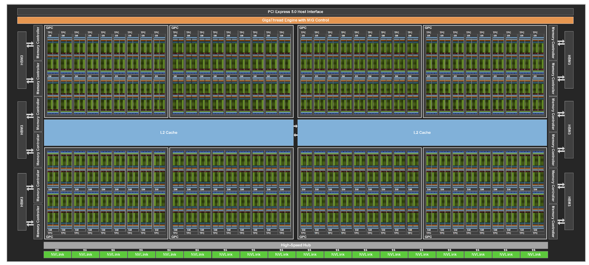{ width="800" }
  <figcaption>H100 (NVLink SXM5) 拓扑结构；PCIe 版本类似</figcaption>
</figure>

上图是 H100( NVLink SXM5 ) 的拓扑结构，H100( PCIe ) 类似。共有 $16 \times 7 + 2 = 114$ 个 SM，共可以组织为 $7$ 个 GPC（切分为 $7$ 个 MIG 虚拟化实例）。数据存储的 Hierarchy 包括：

1. 寄存器（单个 SM 含 $65536$ 个 $32~\mathrm{bit}$ 寄存器共 $256~\mathrm{KB}$;
2. L1 Cache/Shared Memory（单个 SM 共 $256~\mathrm{KB}$，其中 Shared Memory 最多占用 $224~\mathrm{KB}$;
3. L2 Cache 共 $50~\mathrm{MB}$，分为两个 partition 各 $25~\mathrm{MB}$;
4. GPU 侧 HBM2e 共 $80~\mathrm{GB}$，含 $5$ 块 $16~\mathrm{GB}$ HBM2e 芯片;
5. CPU 侧同一节点的主机内存 DDR5 $64~\mathrm{GB}$.

在 Amphere 架构中也存在异步数据搬运（比如 PTX 指令 `cp.async.cg.shared.global [dst], [src], 16;`），存在两个缺陷：其一，单条指令数据搬运量上限为 $16~\mathrm{B}$，大块数据搬运时需要大量的地址计算，即 issue 大量指令；其二，数据搬运指令由 thread 执行，此时 thread 无法从事计算任务，使得计算单元长时间处于空闲状态，利用率不高。

相较于前代 Amphere 架构，Hopper 架构在存储系统最大的改变是加入 TMA( Tensor Memory Accelerator ) 数据搬运部件。每一个 SM 私有一个 TMA，用于异步数据搬运，完全与 thread 解耦，使得 thread 的计算任务与异步访存完全可以并行完成。根据 TMA 数据搬运的 Source 和 Destination 的类型可分为如下几类路径：

- HBM $\longrightarrow$ shared memory( cta );
- HBM $\longrightarrow$ shared memory( cluster );
- shared memory( cta ) $\longrightarrow$ shared memory( cluster );
- shared memory( cta ) $\longrightarrow$ HBM.

由于 TMA 明显优于传统 load/store 数据搬运路径，所以 Hopper 架构下普遍采用的数据加载方式为：

$$
\mathrm{HBM} \overset{\mathrm{TMA}}{\longleftrightarrow} \mathrm{SMEM(cta/cluster)} \overset{\mathrm{LSU}}{\longleftrightarrow} \mathrm{Threads}
$$

-------

  

## 一、经典 LSU 访存路径参数

### 1.1 各 Hierarchy 带宽数据

测试传统的通过 thread 完成的同步 load/store 在不同 memory hierarchy 处的带宽：

<figure markdown id="fig-memory-bw-blocks-cycles">
  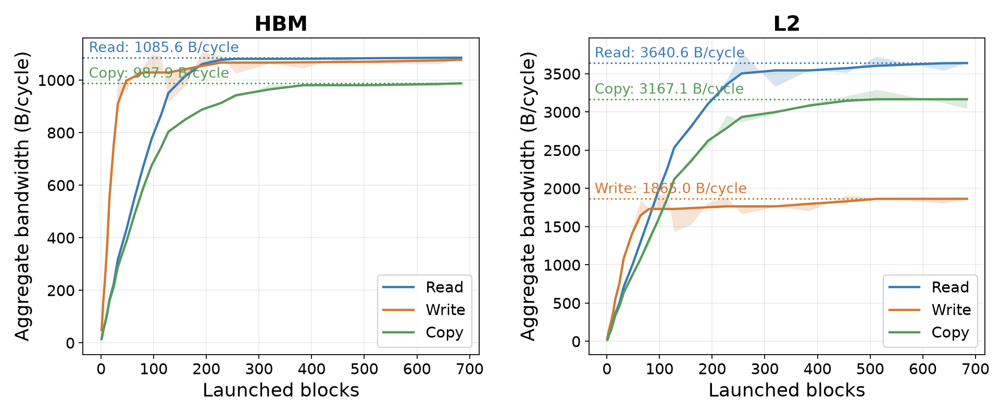{ width="700" }
  <figcaption>LSU 访存带宽随 block 数量的变化</figcaption>
</figure>

通过逐步增加 blocks 的数量以充分逼近 HBM 与 L2 Cache 的带宽饱和点。对于 HBM 而言，读带宽与写带宽均接近 $1100~\mathrm{B/cycle}$. 对于 L2 Cache 而言，读带宽接近 $3600~\mathrm{B/cycle}$，写带宽接近 $1800~\mathrm{B/cycle}$，读带宽几乎是写带宽的二倍。当前 H100 频率上限为 $1.755~\mathrm{GHz}$，则可以得到带宽数据的估计值：

| ITEM | read( HBM ) | write( HBM ) | read( L2 ) | write( L2 ) |
|:----------|------------:|-------------:|-----------:|------------:|
| Bandwidth( GB/s ) | 1930 | 1930 | 6318 | 3160 |

实际的测试结果如下（各项数据基本吻合）：

<figure markdown id="fig-memory-bw-blocks">
  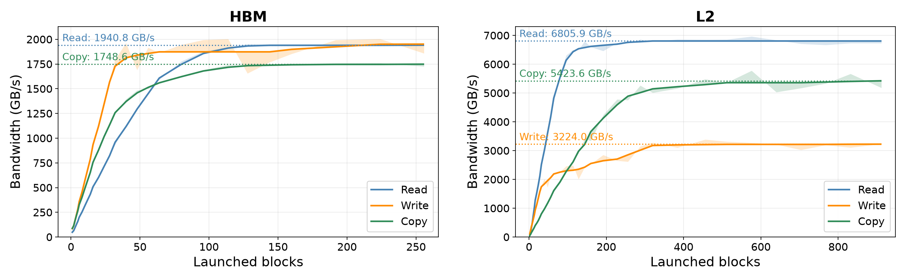{ width="800" }
  <figcaption>HBM 与 L2 Cache 的实测带宽</figcaption>
</figure>

随后是 SM 内部的存储层级，包括 L1 Cache 和 Shared Memory 两类，其实二者是共享同一块 SRAM，但是由于控制电路的差异，实际的访存带宽与访存延迟是不一致的。L1 Cache 与 Shared Memory 的根本差别在于可编程性，前者数据的换入换出完全是硬件控制，对上层完全透明；后者可以固定分配并占用一块 SRAM，数据的写入和读取都是软件可控制的。由于 shared memory 中的数据往往只是 block 内共享的，所以数据的写入只需要 block 内可见即可；但是 L1 Cache 不同，数据有时需要跨 block 保持一致性，那究竟是写入 L1 Cache 还是 L2 Cache 就难以控制了。故 L1 Cache 只测试读带宽。

测试结果如下：

<figure markdown id="fig-memory-local-bw-warps">
  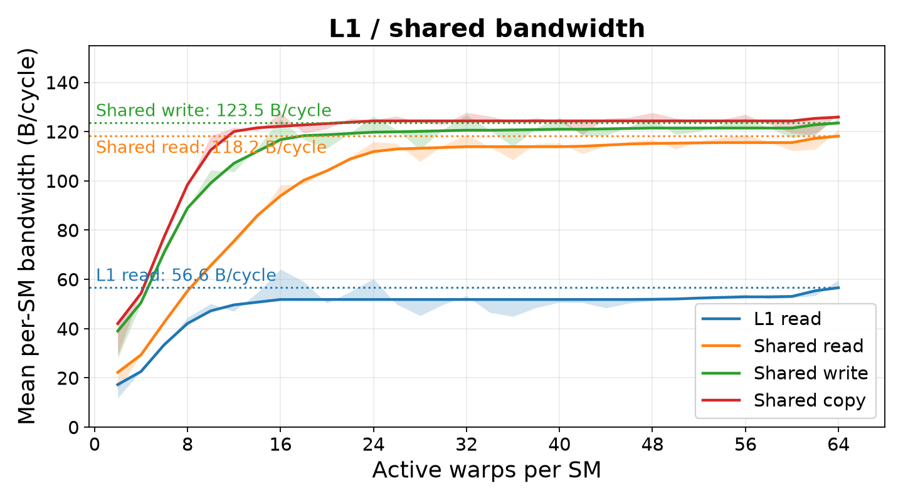{ width="500" }
  <figcaption>L1 Cache 与 Shared Memory 的读写带宽</figcaption>
</figure>

明显看到，Shared Memory 的读写带宽均达到 $\sim 125~\mathrm{B/cycle}$，即 $\sim 220~\mathrm{GB/s}$. 而 L1 Cache 带宽不足其一半，仅 $\sim 52~\mathrm{B/cycle}$，即 $\sim 91~\mathrm{GB/s}$. 这里测试时尽量避免 Shared Memory 的 bank conflict，充分利用其 $32~\mathrm{bank}$ 的并行访存优势，所以这里 Shared Memory 带宽比 L1 Cache 高很多。另外，此处测试的是单个 SM 的数据，扫描的 warp 数从 $2$ 个到 $64$ 个均强制驻留在一个 SM 上，因此该图中带宽与上图整机带宽是不可比的，除非线性 scale $114$ 倍到整机数据，这本身意义不大。

-----

 

### 1.2 各 Hierarchy 延迟数据

以上是带宽数据，我另外通过构造串行 dependent chain 测试 L1 Cache/L2 Cache/HBM 这条链路上的访存延迟，测试延迟时只使用单 block 单 thread 发起访存请求，不存在访存合并与竞争干扰，台阶状的曲线如下所示：

<figure markdown id="fig-memory-latency-workset">
  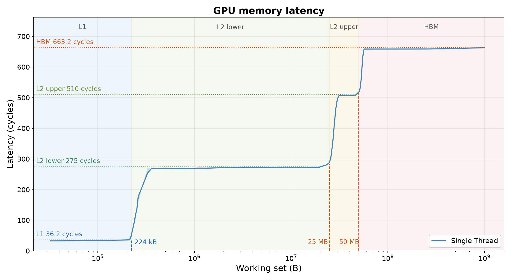{ width="500" }
  <figcaption>L1 / L2 / HBM 访存延迟随 working set 的变化</figcaption>
</figure>

据图，L1 Cache 延迟约 $36~\mathrm{cycles}$，容量为 $\sim 224~\mathrm{KB}$，尽管 L1 Cache + Shared Memory 共用的 SRAM 大小为 $256~\mathrm{KB}$，但是各自使用的上限都是 $224~\mathrm{KB}$，不能完全占用。有趣的是在 L2 Cache 这里出现两个 stairs？第一块大小为 $25~\mathrm{MB}$，属于靠近该 thread 的 local L2 Cache；第二块大小也为 $25~\mathrm{MB}$，属于远离该 thread 的 remote L2 Cache. 两块 L2 Cache 之间通过 LTCFABRIC 互联，当一块访存请求落入 L2 Cache 之后会发生：

1. 查看 local L2 Cache 是否命中，若命中则直接返回数据，额外开销是 $275-36=239~\mathrm{cycles}$；若不命中，请求发送至 remote L2 Cache;
2. 查看 remote L2 Cache 是否命中，若命中则直接返回数据，额外开销是 $510-275=235~\mathrm{cycles}$；若不命中，请求发送至 HBM.

可以看到，从 L1 miss 到 local L2 Cache 的开销与 local L2 miss 到 remote L2 Cache 的开销是高度接近的，最主要的是确实观察到 L2 Cache partition 带来的访问延迟的异质性。此外，CPU host memory 的延迟为 $\sim 1655~\mathrm{cycles}$，Shared Memory 的延迟为 $\sim 29~\mathrm{cycles}$（甚至比 L1 还要快一点）。

再深究一点，想观察一下两个 level 的缓存（L1 Cache 与 L2 Cache）各自的 sector 大小，所谓 sector 就是一个 cacheline 的组成单元，当该级缓存 miss 之后，从下一级缓存加载的数据粒度是多少，比如一次加载 $32~\mathrm{B}$ or $64~\mathrm{B}$? 测试方法是做一块地址连续的数据的扫描，通过逐渐增大 stride 来观察单步数据加载延迟的变化，通常会有清晰的拐点。

<figure markdown id="fig-memory-latency-stride">
  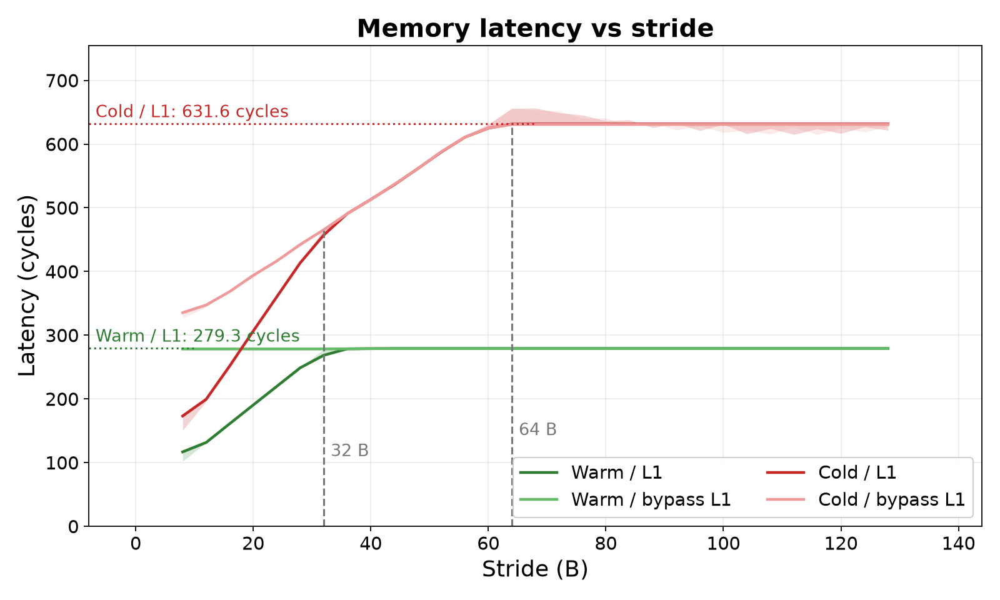{ width="500" }
  <figcaption>加载延迟随访问 stride 的变化（拐点即 sector 大小）</figcaption>
</figure>

观测值是 cycles per hop，即单次数据加载的延迟。当加载数据经过 L1 Cache 时，无论是 warm L2（提前把数据加载到 L2）还是 cold L2（数据全部在 HBM），都会在 $32~\mathrm{B}$ 这里出现拐点，表明每次 L1 Cache miss 之后会从 L2 Cache 处加载 $32~\mathrm{B}$ 的数据。为何会出现拐点？考虑一下 stride 为 $16~\mathrm{B}$ 与 $32~\mathrm{B}$ 两种情况：若 stride 为 $16~\mathrm{B}$，某一次 L1 miss 之后会加载连续的 $32~\mathrm{B}$ 数据进 L1，下一个 $16~\mathrm{B}$ 数据一定是 hit 的，单次 miss 的开销被均摊到两次 load；若 stride 为 $32~\mathrm{B}$，则每一次 L1 miss 之后只能把当次的 $32~\mathrm{B}$ 数据加载进来，下一个 $32~\mathrm{B}$ 数据一定仍然 miss，单次 miss 的开销只能这一次 load 承担。

而一旦 stride 大于或等于 $32~\mathrm{B}$ 之后，每一次必然 miss，所以 warm 这两条曲线（ via L1/bypass L1）在 $32~\mathrm{B}$ 之后持平。cold 这两条曲线能看到第二个拐点在 $64~\mathrm{B}$ 处，与 L1 Cache 的分析类似，这个点就是 L2 Cache 的 sector 大小，即 $64~\mathrm{B}$. 一旦 stride 大于或等于 $64~\mathrm{B}$ 之后，每一次必然 L2 Cache miss 进而从 HBM 加载数据，所以后面持平。

L2 Cache 的 sector 大小是 $64~\mathrm{B}=512~\mathrm{bit}$，其实也与 memory controller 单个 transaction 为 $512~\mathrm{bit}$ 宽度保持一致。进一步地，L1 Cache 的 sector 大小是 $32~\mathrm{B}=256~\mathrm{bit}$，则猜测与 L1 Cache 平级的 TMA 的单个 request 访存粒度应该也为 $32~\mathrm{B}$.

------

  

## 二、TMA 数据搬运参数

这里首先引用一下 [FlashGPU-sim](https://arxiv.org/abs/2609.15311) 文章中对 TMA 硬件的建模方式，后面可以逐渐验证其部分正确性：

<figure markdown id="fig-tma-model-flashgpu">
  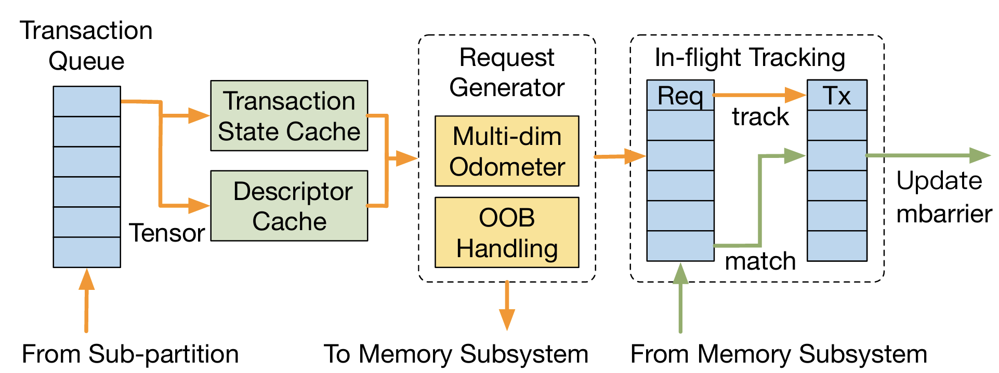{ width="600" }
  <figcaption>TMA Microarchitecture Model</figcaption>
</figure>

TMA 是每一个 SM 独占的硬件，其通过 `cp.async.bulk` 指令做连续区域数据的搬运。因此，单条 TMA 操作指令的延迟依赖于【路径延迟】与【数据搬运量】，比如从 HBM 搬到 shared memory 到时间开销会高于从 L2 Cache 搬运到 shared memory，搬运 $8~\mathrm{KiB}$ 数据的开销会高于 $4~\mathrm{KiB}$. 下面首先测量 TMA 的延迟参数再测量 TMA 带宽参数。

-----

 

### 2.1 TMA 延迟参数

测量延迟，需要构造 dependent operation chain. 虽然访存指令无法构造数据依赖，但通过 `mbarrier` 或者 `wait_group` 可以利用同步来等价地实现依赖。下面首先测试两个方向的 TMA 数据搬运延迟，分别是 global memory $\overset{\mathrm{TMA}}{\longrightarrow}$ shared memory 与 shared memory $\overset{\mathrm{TMA}}{\longrightarrow}$ global memory. 延迟的测试结果如下：

<figure markdown id="fig-tma-latency-workset">
  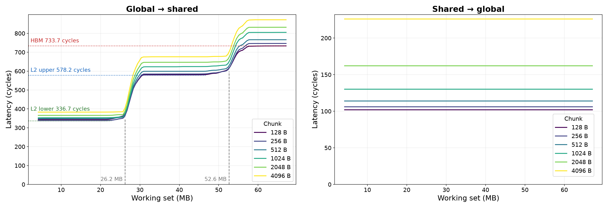{ width="800" }
  <figcaption>TMA 双向搬运延迟随 working set 与 per-hop copy size 的变化</figcaption>
</figure>

对于 TMA 从 HBM 加载数据到 Shared Memory 而言，依然呈现明显延迟分级，包括 L2 local latency 一级、L2 remote latency 一级、HBM latency 一级，三级之间延迟差异非常明显。另外，单次 TMA 数据搬运的 copy size 也会影响延迟，在测试的几组 copy size 里也呈现明显的分级现象。对于 TMA 从 Shared Memory 把数据存到 global memory 而言，固定一个 chunk size，无论我如何调整目标地址的 working set 大小（无论是否超过 L2 local partition 还是整个 L2 cache），延迟恒定不变；只有改变单次 TMA 数据搬运的 chunk size 才会影响延迟的大小。

我尝试做出如下推测，global memory $\overset{\mathrm{TMA}}{\longrightarrow}$ shared memory 依然遵从一般的存储访问路径，一点点溢出 L2 local cache，一点点溢出 L2 remote cache 都会影响数据加载的延迟；shared memory $\overset{\mathrm{TMA}}{\longrightarrow}$ global memory 则不同，其会将数据写入 L2 Cache. 如果需要先将 L2 Cache 中原有数据 exit 到 HBM，则由于 evict 的过程与 TMA request 数据写入 L2 Cache 的过程是异步的（并行完成），故吃不到 HBM 写入延迟。这样 working set 的变化不会影响低并发下 shared memory $\overset{\mathrm{TMA}}{\longrightarrow}$ global memory 的写入延迟。

-----

 

### 2.2 TMA 带宽参数

延迟测试结束后看一下带宽数据，测试 TMA 从 global 加载数据到 shared memory 的带宽：

<figure markdown id="fig-tma-g2s-bw-tiers">
  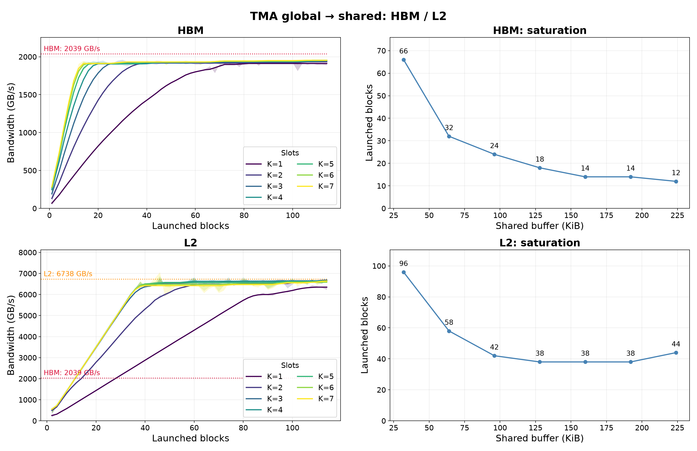{ width="700" }
  <figcaption>TMA global → shared 的聚合带宽</figcaption>
</figure>

测试是固定一个 slot 大小为 $32~\mathrm{KiB}$，通过变化 slot 的数量和 SM 的占用来测试 TMA 加载数据的带宽（其实 SM 数量变化是在改变使用的 TMA 数量）。可以发现，无论是从 HBM 加载数据还是从 L2 Cache 加载数据，当 TMA 数量达到一定程度时都可以打满 HBM 带宽或者 L2 Cache 的带宽，而且很自然地，打满带宽所需要的 TMA 数量会随着 chunk size( slot size ) 的增加而减少（因为 chunk size 越大代表 TMA 数据搬运指令 issue 的开销被摊销地很薄，更纯粹地在做数据搬运）。所以从该图看来，TMA 本身不是数据加载的瓶颈，瓶颈仍然是 HBM 带宽和 L2 Cache 的带宽。

再测试一下从 shared memory 写回到 global memory 的带宽：

<figure markdown id="fig-tma-s2g-bw-total">
  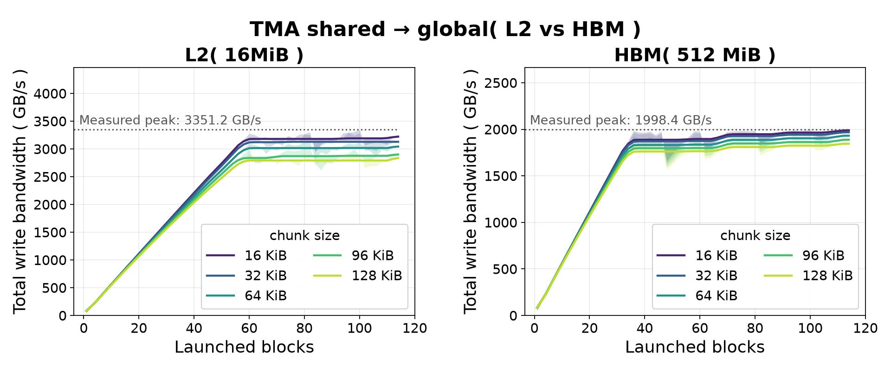{ width="800" }
  <figcaption>TMA shared → global 的聚合带宽</figcaption>
</figure>

这里我发现大量的 TMA 发起写数据请求时，如果 working set 可被 L2 Cache 容纳，则最终饱和写入带宽即为 L2 Cache 写入带宽，总吞吐最终会维持在 $\sim 3350~\mathrm{GB/s}$ 的水平。如果 working set 溢出 L2 Cache，则将受到 HBM 写入带宽的限制，即 $\sim 2000~\mathrm{GB/s}$.

TMA 在 shared memory 和 global memory 之间搬运数据，如果从一个 SM 的角度来看带宽，测试 launch 不同数量 blocks 的情况下的带宽竞争，可以基本确定 global $\overset{TMA}{\longleftrightarrow}$ shared 下单个 TMA 发出数据和接收数据的带宽。比如接收数据：

<figure markdown id="fig-tma-g2s-bw-block">
  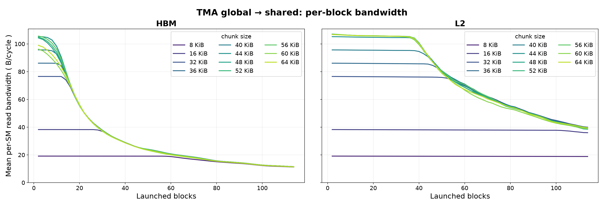{ width="800" }
  <figcaption>单个 TMA 的 global → shared 带宽</figcaption>
</figure>

数据源可以是 HBM 也可以是 L2 Cache，主要差别在于 working set 的大小是否可以被 L2 Cache 容下。可以看到，无论是 HBM 还是 L2 local，两种情况下单个 TMA 带宽最大值都是 $\sim 105~\mathrm{B/cycles}$，在频率上限为 $1.755~\mathrm{GHz}$ 的假设下，带宽饱和值为 $\sim 184~\mathrm{GB/s}$. 这个明显不是 HBM 或者 L2 Cache 的带宽饱和值，所以应该是 TMA 的硬件限制，推测 TMA 在 global $\longrightarrow$ shared 这个路径下带宽上限为 $\sim 105~\mathrm{B/cycle}$.

再比如写回数据：

<figure markdown id="fig-tma-s2g-bw-block">
  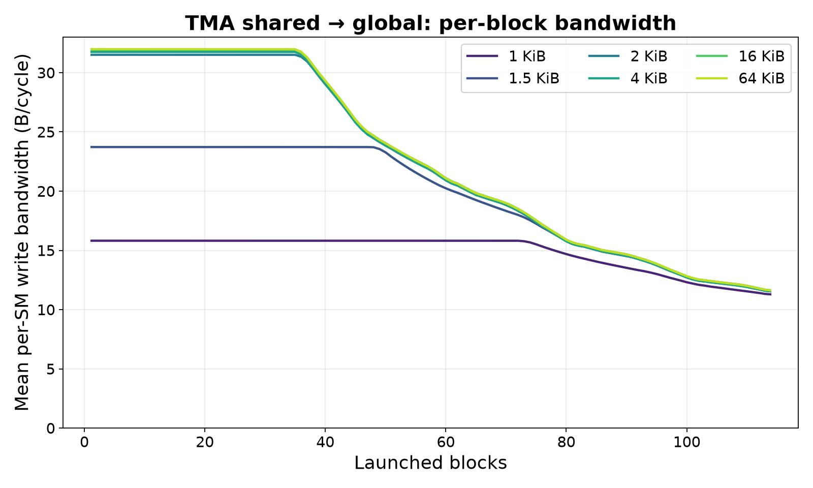{ width="500" }
  <figcaption>单个 TMA 的 shared → global 带宽</figcaption>
</figure>

对于单个 TMA 而言，其 shared memory $\longrightarrow$ global memory 的带宽为 $\sim 32~\mathrm{B/cycle}$. 比接收数据要小得多。为何 TMA 数据加载和数据写回的带宽要不对称？从实际的计算场景分析即可，比如大矩阵乘法中一个 SM 负责一块 $C_{ij} \in \mathbb{R}^{256\times 256}$ 的 tile，则该 SM 的数据流入将是 $256$ 行 $A$ 矩阵数据和 $256$ 行 $B$ 矩阵数据，而数据流出仅仅是 $256 \times 256$ 个 $C$ 矩阵元素，这完全不是一个量级的。读入流量与写出流量的高度不对称性塑造了实际的硬件设计方案。

------

 

### 2.3 单个 TMA 带宽建模

尝试对单个 TMA 的带宽做一下建模，这里我们只使用一个 SM（也就是使用一个 TMA），在单个 SM 可用的 shared memory 上限（应为 $224~\mathrm{KB}$）的限制下尽可能地开更多的 slot（每个 slot 大小为 chunk size），数量为 $K$，每次从 global memory 中搬运数据的大小也为 chunk size. 基于这样的测试方式，分别令 working set 大小为 $512~\mathrm{MiB}$ 与 $16~\mathrm{MiB}$，结果如下：

<figure markdown id="fig-tma-g2s-bw-grid">
  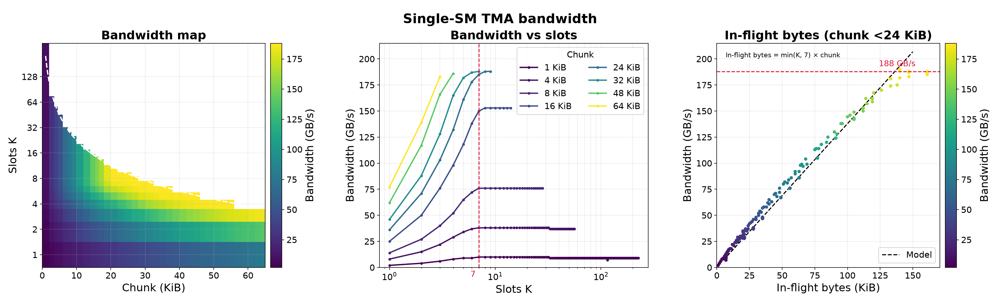{ width="800" }
  <figcaption>单个 TMA 带宽模型（HBM）：chunk size × slots 扫描</figcaption>
</figure>

<figure markdown id="fig-tma-g2s-bw-grid-l2">
  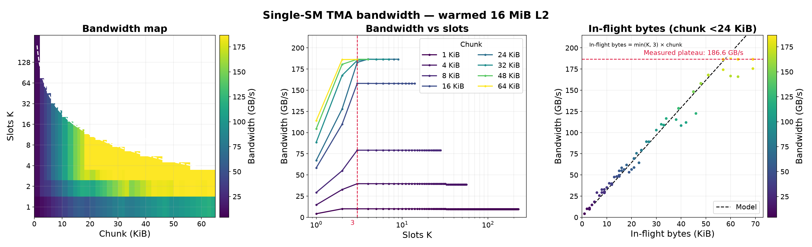{ width="800" }
  <figcaption>单个 TMA 带宽模型（L2 Cache）：chunk size × slots 扫描</figcaption>
</figure>

有如下结论：

1. 单个 TMA 带宽（从 HBM 加载或从 L2 加载）饱和值均约为 $180~\mathrm{GB/s}$.
2. 受限于 TMA 数据搬运指令的 issue 延迟以及 TMA 发射槽大小，当 chunk size 很小时，尽管有非常多的 slots 仍然无法打满带宽；当 chunk size 很大时，使用很少的 slots 即可打满带宽。
3. 通过对固定 chunk size 做 slots 扫描，发现对于较小的 chunk size，从 HBM 加载数据时吞吐饱和点普遍为 slots 等于 $7$ 时，从 L2 Cache 加载数据时吞吐饱和点普遍为 slots 等于 $3$ 时。
4. 通过数据拟合，发现 chunk size 比较小时（如 $\le 24~\mathrm{KiB}$），TMA 带宽满足如下表达式：

$$
\begin{align*}
\mathrm{from~HBM} \longrightarrow \mathrm{BW} \propto \min\{K,7\} \times \mathrm{chunk\_size} \tag{1} \\[5px]
\mathrm{from~L2} \longrightarrow \mathrm{BW} \propto \min\{K,3\} \times \mathrm{chunk\_size} \tag{2}
\end{align*}
$$

这两批数据可以如何理解？对于某一个 chunk size 而言，TMA 吞吐上限是多少，应该如何确定这个上限？

实际上，单个 TMA transaction 会被拆分为若干个细粒度的 request 来处理，而 request 已发出但暂时还没有返回数据的称为 in-flight bytes，TMA 中自然需要有一个 table 来维护所有的 in-flight data. 那么，TMA 吞吐达到饱和就应该有两种情况：

- 其一，由于这张 in-flight track 表有容量上限，一旦达到这个上限 TMA 就不能继续发出 request，则 in-flight bytes 达到饱和，自然也就意味着 TMA 带宽打满，出现【断流】。这种情况下的瓶颈是 TMA 发出 request 的数量上限（这是我一开始的分析）。
- 其二，这张 in-flight track 表的上限不会被达到，实际情况是当 TMA 还在继续发出 request（即 track 表还没占满）时，前面发出的 request 返回数据已经回来，形成稳定的数据流。这种情况下的瓶颈是 TMA 发出 request 的速率快慢。

假设第一个瓶颈成立，由于 TMA issue 一个 transaction 本身有延迟，那么持续 issue chunk size 比较大的 transaction 会更容易触碰到 track 表的上限。另外，出现断流意味着平均带宽应该与路径延迟呈反相关的关系，从 HBM 加载数据的平均带宽应明显小于从 L2 Cache 加载数据的带宽。这是基于假说一得到的两个推论，但是基于[【单个 TMA 的 global → shared 带宽】](#fig-tma-g2s-bw-block)测试结果，HBM 和 L2 两种情形下大 chunk size 的加载带宽是一致的，都在 $\sim 105~\mathrm{B/cycle}$. 故第一个假设不成立，in-flight track 表容量有上限，但是当前根本无法触及该上限。

对于第二个瓶颈，关键就是让 TMA 一直有 request 发，可以计算一下数据搬运过程中两段时间开销，分别是 $t_{\mathrm{issue}}$ 与 $t_{\mathrm{total}}$，前者是 TMA 将该 transaction 拆分为若干小的 request 并全部发出的时间，后者是 TMA 完全完成该 transaction 的时间，即 $t_{\mathrm{issue}}$ 是 $t_{\mathrm{total}}$ 的第一段。假设：

- chunk size 为 $C$ byte;
- TMA 发出 request 的速率为 $R_{1}$ byte/cycle;
- TMA 接收数据的速率为 $R_{2}$ byte/cycle;
- TMA 将一个 transaction 拆分为 request 并全部发出的固定时间开销为 $t_{\mathrm{fixed}}$ cycle;
- 单个 request 从发出后到返回数据给 TMA 的延迟为 $t_{\mathrm{route}}$ cycle.

实验结果显示：

$$
\begin{cases}
t_{\mathrm{issue}} = t_{\mathrm{fixed}} + \frac{C}{R_1} \\
t_{\mathrm{total}} = t_{\mathrm{route}} + \frac{C}{R_2}
\end{cases}
\quad\Longrightarrow\quad
K_{\mathrm{sat}} =
\left\lceil
\frac{t_{\mathrm{total}}}{t_{\mathrm{issue}}}
\right\rceil
$$

计算出来的 $K_{\mathrm{sat}}$ 就是该 chunk size 达到饱和带宽的 slot 数，本质上就是利用连续的 $K_{\mathrm{sat}}$ 次 issue 延迟掩盖 $t_{\mathrm{total}}$ 的开销，保证 TMA 总是有 request 需要发出，以第二种方式达到饱和带宽。因此，可以推导：

$$
\frac{t_{\mathrm{total}}}{t_{\mathrm{issue}}} = \frac{t_{\mathrm{route}}+\frac{C}{R_{2}}}{t_{\mathrm{fixed}}+\frac{C}{R_{1}}} = \frac{R_{1}}{R_{2}}(\frac{C+R_{2}t_{\mathrm{route}}}{C+R_{1}t_{\mathrm{fixed}}}) \quad \Longrightarrow \quad
\begin{cases}
\frac{t_{\mathrm{route}}}{t_{\mathrm{fixed}}}, & C \to 0\\[10px]
\frac{R_{1}}{R_{2}}, & C \to \infin \\
\end{cases}
$$

对于 chunk size 比较小的情况，关键是 $t_{\mathrm{route}}$ 的大小，前面 latency 测试中 $t_{\mathrm{HBM}}$ 为 $\sim 663~\mathrm{cycles}$，$t_{\mathrm{L2}}$ 为 $\sim 275~\mathrm{cycles}$. 所以从 HBM 加载数据达到饱和所需要的 slot 数量大约是从 L2 Cache 加载数据情形的 $\frac{663}{275} = 2.4$ 倍，符合前面 slot 饱和值 $3$ 与 $7$ 的测试结果。在 slot 数小于饱和值时，$\mathrm{slot} \times \mathrm{chunk\_size}$ 即为 in-flight bytes，正比于实际测试的带宽；而当 slot 数达到饱和值后，继续增加 slot 并不会影响实际 in-flight bytes，故数据吞吐达到上限。所以用 in-flight bytes 计算带宽的建模方式即为 [式(1)(2)](#eq-tma-bw-model) 所示。另外也发现，thread issue 单条 TMA 指令普遍需要 $45~\mathrm{cycles}$.

-----

 

### 2.4 TMA issue 建模

TMA 的发射槽有 $8$ 个，可以验证一下。虽然 `cp.async.bulk` 作为 TMA 异步数据搬运的指令，但是不意味着 TMA 可以接受无限并发的 `cp.async.bulk` 指令。简单来说，一个 TMA 的 `cp.async.bulk` 指令发射槽是有限的，一旦全部的发射槽被占用，后面 issue 的 `cp.async.bulk` 指令就会被阻塞住，等待当前已经 issue 的某一数据搬运指令结束后再进入发射槽。因此，当我们逐渐提高 independent 的 `cp.async.bulk` 指令流的长度时，理论上应该可以看到指令发射时间会出现明显的跳变：

<figure markdown id="fig-tma-dsm-admission">
  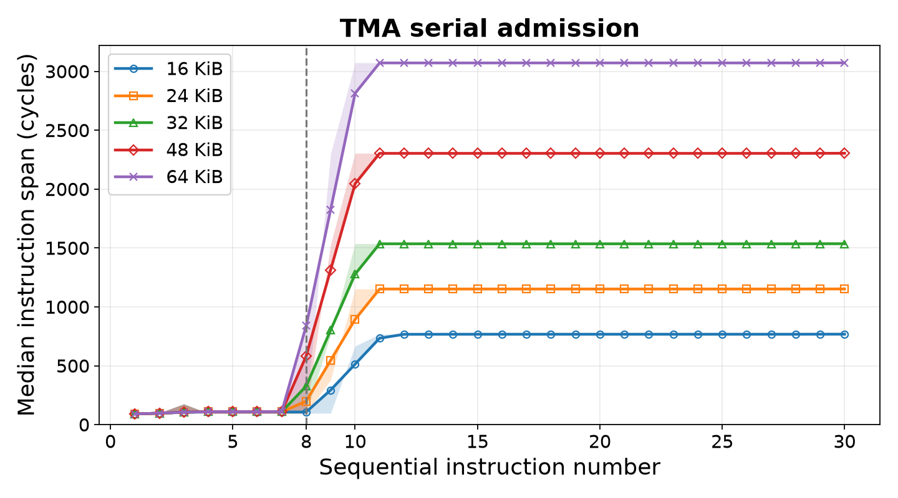{ width="500" }
  <figcaption>TMA 指令发射开销随独立指令流长度的变化（跃迁点 = 8）</figcaption>
</figure>

测试使用的是 shared::cta $\overset{\mathrm{TMA}}{\longrightarrow}$ shared::cluster 类型的 `cp.bulk` 指令，用于在一个 GPC 范围内 distributed shared memory 里做数据搬运。在单个 SM 的单线程上连续 issue 多条 TMA 数据搬运指令来观察何时出现阻塞（ issue span 会出现跃迁）。在扫描不同的 chunk size 后，发现共同的跃迁点就是 $8$，所以此处的结论是说单个 SM 的 TMA 的发射槽空间为 $8$，即某一个时刻最多只会允许 $8$ 个 active TMA transaction，这是一个很可靠的硬件上限数据。

既然观察到 TMA 发射槽数，下一个问题是，假设 TMA 的发射槽中存在多条 TMA 数据搬运指令，这些指令执行的顺序是什么？是完全按序执行且没有并发？是各个 active TMA transaction 完全并发（可以轮询）？TMA 单个 transaction 可以是很大块的数据，TMA 在硬件层面会将大的 transaction 拆分为许多细粒度的固定长度的 request，这些 request 相当于 TMA 版本的 L2 Cache/HBM 向 L1 Cache 的流动。因此，前面的问题【这些指令执行的顺序是什么？】等价于不同 transaction 拆分出来的 request 发出的先后顺序如何？按照 transaction 排序发出还是可以交错发出？下面做了一点测试：

<figure markdown id="fig-tma-dsm-fanout-arrival">
  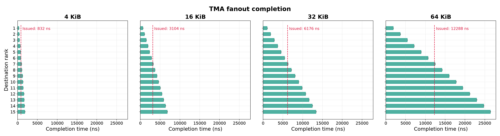{ width="800" }
  <figcaption>16-SM cluster 内各 consumer 的接收完成时间（呈等差数列）</figcaption>
</figure>

测试思路：在一个 $16$ SM 构成的 cluster 中，令 rank0 上的 thread 作为 producer，将本 SM 的 shared memory 中的数据通过 TMA 搬运到其他 $15$ 个 SM 的 shared memory，记录从 producer 开始 issue TMA 指令到每一个 consumer 完全接收到数据的时间开销。做了 $4$ 组不同的 chunk size，均表现出明显的【等差数列】的形式，即 TMA 的发射槽是以队列的形式组织的，惟有当前 transaction 的全部 request 完全发出后才会开始处理下一个 transaction，即 transaction 的处理是串行化的。不存在【发射槽中各个 transaction 的 request 轮询】这样的机制，否则各个 transaction 完成的时间应该很相近，表现出来的现象就是各个 consumer rank 接收到数据的时间是接近的（TMA 指令 issue 的时间差相较于数据搬运的时间可以忽略不计了）。

此外，图中额外标出 rank0 从开始 issue TMA 指令到全部 issue 完毕这段时间的长度，在不同 chunk size 下有相同之处，当前 $7$ 条 TMA 指令执行完的时候所有的 $15$ 条 TMA 指令全部发出。换句话说，当第 $7$ 条 TMA 指令在执行时，此时 TMA 发射槽里面是 $\mathrm{inst}_{7} \sim \mathrm{inst}_{14}$，则 $\mathrm{inst}_{15}$ 还在被阻塞导致 rank0 没法全部 issue. 当 $\mathrm{inst}_{7}$ 结束后空出一个 slot，$\mathrm{inst}_{15}$ 才最终 issue. 这再次证明 TMA 的 issue slots 数量是 $8$.

------

 

### 2.5 DSM 参数测试

既然谈到 distributed shared memory，其本身作为 Hopper 架构开始的一项硬件机制，是很有趣的。Hopper 架构在 SM 和 GPU 之间又引入一个 organization layer，称为 GPC( Graphic Processing Unit )，通过将一定数量的 SM 组织起来构成一个 cluster，而个人认为组织的纽带中最重要的就是 distributed shared memory. 

最普遍的一个计算场景就是大矩阵乘法 $C=A \times B$，一般情况下会将 $C$ 矩阵 tile 化为一个个 $C_{ij} \in \mathbb{R^{256 \times 256}}$ 的 tile（注意不是 $C[i][j]$，这个指的是单个 $C$ 矩阵元素），每一个 SM 会负责计算一个 $C$ tile，这就需要单个矩阵加载 $A$ 矩阵对应的 $256$ 行与 $B$ 矩阵对应的 $256$ 列，这对带宽的压力很大。这时我们会想到相邻的 SM 其实是在计算相邻的 $C$ tile，比如 $C_{1,2}$ 与 $C_{1,3}$ 两个 tile，而计算这两个 tile 其实是需要用到相同的 $128$ 行 $A$ 矩阵数据，即可以共享。此时由 cluster 里的一个 thread 发起 TMA 数据搬运指令，从 HBM 加载数据到自己的 shared memory，再同时 broadcast 到同 cluster 的其他 shared memory 中，可以显著降低对 HBM/L2 Cache 的带宽压力。此外，同一个 cluster 的不同 SM 也可以通过 TMA 互相搬运数据（通常是由发送方 issue TMA 指令，即“只能给，不能要”），只有 shared::cta $\overset{\mathrm{TMA}}{\longrightarrow}$ shared::cluster，而不存在 shared::cluster $\overset{\mathrm{TMA}}{\longrightarrow}$ shared::cta.

#### 2.5.1 一对一数据搬运

下面我们首先来测试通过 TMA 在 cluster 内实现点到点数据搬运的延迟，只在 SM0 和 SM1 之间做 ping-pong 测试，通过 mbarrier 来做同步和 TMA 数据搬运完成的 signal，单轮 ping-pong 测试是 SM0 $\overset{\mathrm{TMA}}{\longrightarrow}$ SM1  $\overset{\mathrm{TMA}}{\longrightarrow}$ SM0，记录时间后减半得单程数据搬运延迟，测试结果如下：

<figure markdown id="fig-tma-dsm-latency-chunk">
  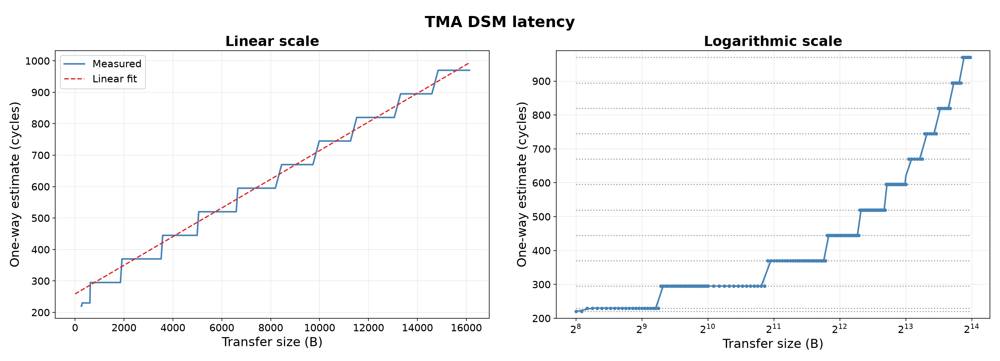{ width="700" }
  <figcaption>cluster 内点对点 TMA 搬运延迟（台阶由 mbarrier polling 造成）</figcaption>
</figure>

可以看到随着 chunk size 的增大，TMA 数据搬运的延迟呈现离散的台阶状增长，原因在于 mbarrier 同步的机制。mbarrier 是 shared memory 中的一个对象，线程需要通过不断地轮询（polling）来获取 mbarrier 状态从而判断 TMA 数据搬运的 transaction 是否完成。这个 polling 不是没有开销的，对于测试时使用的 `mbarrier.try_wait.parity` 指令（不加 hint），单次 polling 开销大约为 $150~\mathrm{cycles}$. 因此，每当 TMA 搬运的数据量增加一定数量时，轮询的次数就会增加一次，测试到的延迟就会上一个台阶。因为图像中的数据是原始数据的一半（原始是一个 ping-pong 往返，这里是单程），所以台阶高度自然就是 $\sim 150/2 = 75~\mathrm{cycles}$.

另外，台阶曲线近似得到的直线斜率大约为 $0.046$，取其倒数为 $21.7~\mathrm{B/cycle}$. 所以对于一个 DSM 内的点对点的数据搬运，TMA 的带宽大约为 $21.7~\mathrm{B/cycle}$，不过这是否打满还有待验证。会引出后面的 fan-in 和 fan-out 测试。

#### 2.5.2 一对多数据搬运

所谓 fan-out 测试是指，在 $16$ 个 SM 构成的 cluster 内令 rank0 为数据 src，其他 $15$ 个 rank 为数据 dst. 令 rank0 以高并发（连续 issue TMA 指令）将本 SM shared memory 数据搬运到其他 SM 的 shared memory 中。记录的时间，从 rank0 issue 第一个 TMA 数据搬运指令起，到最后一个 rank 完全接收到自己的那份数据止。测试结果如下：

<figure markdown id="fig-tma-dsm-fanout-bw">
  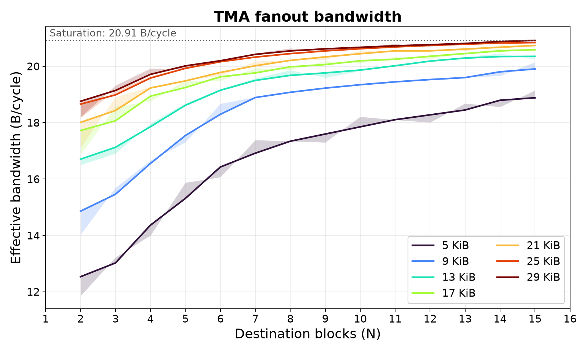{ width="500" }
  <figcaption>fan-out 吞吐随 chunk size 与指令条数的变化</figcaption>
</figure>

由于 TMA 数据搬运指令 issue 本身也需要时间，所以随着 issue 的条数和单次 transaction chunk size 大小逐渐增加，TMA issue 的开销被逐渐稀释掉，吞吐速率逐渐逼近带宽饱和值。可以看到饱和值大约在 $21.5~\mathrm{B/cycle}$ 左右，与前面我们通过台阶状曲线得出的数据是一致的，则 TMA 在 shared::cta $\longrightarrow$ shared::cluster 的方向上的带宽为 $21.5~\mathrm{cycle}$.

再具体一点的话，可以观察 cluster 内的 SM 里面最早全部接收数据的延迟是多少，最晚全部接收数据的延迟是多少，以及二者关于 chunk size 变化的情况：

<figure markdown id="fig-tma-dsm-fanout-latency-3d">
  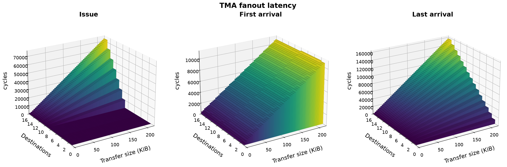{ width="800" }
  <figcaption>fan-out 延迟分解：issue 开销 / 最早到达 / 最晚到达</figcaption>
</figure>

从测试的统计数据中可以做如下分析：

1. 图一是 rank0 issue $N$ 条搬运指令的开销，这里再一次在 $N=8$ 那里出现跃迁，验证 TMA 发射槽的数量为 $8$ 条。此外，$N > 8$ 时，issue 的总开销是随着 chunk size 线性变化的，这验证前面的结论：TMA 的 transaction 是一条一条串行处理的，不存在轮询或其他机制。
2. 图二是 cluster 中最早接收数据的 rank 完全接收数据的时间，其实就是从 rank0 开始 issue 到第一个 transaction 结束的时间。很自然地，这段延迟与 $N$ 没有关系，只是关于 chunk size 线性增长。
3. 图三是 cluster 中最晚接收数据的 rank 完全接收数据的时间，其实就是从 rank0 开始 issue 到最后一个 transaction 结束的时间。基于前面【transaction 处理过程是串行的】结论，我们可以建模，令 $C$ 为 transfer size，$N$ 为 transaction 的数量，$A$ 为数据传输速率，则这里的延迟即为 $A\times N\times C$，关于 transfer size 和 $N$ 都是线性变化的。

#### 2.5.3 多对一数据传输

测试完 fan-out，再来观察一下 fan-in 的情况。与 fan-out 相反，fan-in 是【多对一】的形式，在一个 cluster 内，rank0 是各个 TMA transaction 的目的地，剩下的所有 rank 都是 TMA transaction 的源，由各个源同时向 rank0 push 数据，观察一下总的时间开销情况。测试结果如下：

<figure markdown id="fig-tma-dsm-fanin-bw">
  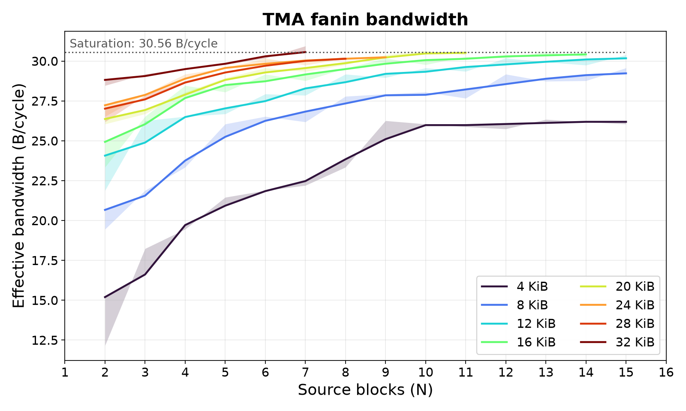{ width="500" }
  <figcaption>fan-in 吞吐（多源竞争 TMA 接收端口）</figcaption>
</figure>

同样地，吞吐依然随着 $N$ 的增加与 chunk size 的增加而增加，最终接近于带宽饱和值 $\sim 30.5~\mathrm{cycles}$. 这其实是在多个数据源竞争 TMA 接收端口下 TMA 接收能力的上限，所以 TMA 输入带宽可以认为是 $\sim 30.5~\mathrm{cycles}$.

另外，测试 cluster 内任意两个 rank 之间的 TMA 数据搬运开销，均非常接近，未能从传输延迟中推断出相应的拓扑结构。

------

  

## Summary

<figure markdown id="fig-bandwidth">
  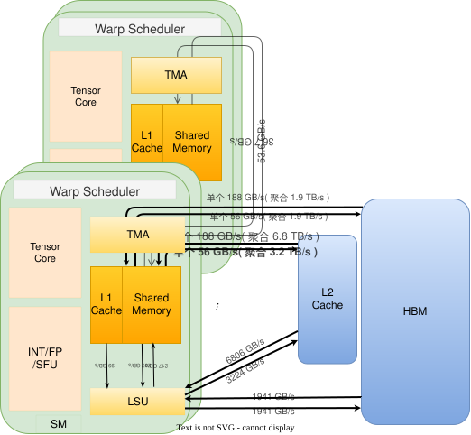{ width="500" }
  <figcaption>各级存储与数据通路的带宽总览</figcaption>
</figure>

一些重要的结论：

1. TMA 虽然会限制单个 SM 数据吞吐到 $\sim 190~\mathrm{GB/s}$，但所有 SM 的 TMA 聚合吞吐可以达到 $\sim 2.0~\mathrm{TB/s}$ for HBM, $\sim 6.8~\mathrm{TB/s}$ for L2 Cache，即打满 HBM 或者 L2 Cache 带宽，不存在带宽浪费。
2. TMA 可以显著减少数据搬运对 thread 的占用，提高计算资源的 occupancy.
3. 在 GPC distributed shared memory 层面使用 TMA 可以降低数据流对 L2 Cache 和 HBM 的带宽压力。
4. 无论是 shared::cta $\overset{\mathrm{TMA}}{\longrightarrow}$ shared::cluster 还是 shared::cta $\overset{\mathrm{TMA}}{\longleftrightarrow}$ global memory，TMA “入”带宽均明显大于“出”带宽，具有高度不对称性。
5. TMA 处理 memory transaction 时会将其拆分为若干细粒度 request（猜测是 $32~\mathrm{B}$ 大小的），可以尝试在 write request 数据发出前做好 encoding，在 read request 数据返回后做 decoding. 这样相当于只增加一级流水线，并不会带来显著的 encoding-decoding 开销。

------

## References:

1. [《FlashGPU-sim: Enabling GPU Modeling for Modern Architectures and AI Workloads》](https://arxiv.org/abs/2609.15311)
2. [《Parallel Thread Execution ISA Version 9.4》](https://docs.nvidia.com/cuda/parallel-thread-execution/index.html)
3. [NVIDIA H100 Tensor Core GPU
Architecture 白皮书](https://resources.nvidia.com/en-us-hopper-architecture/nvidia-h100-tensor-c)